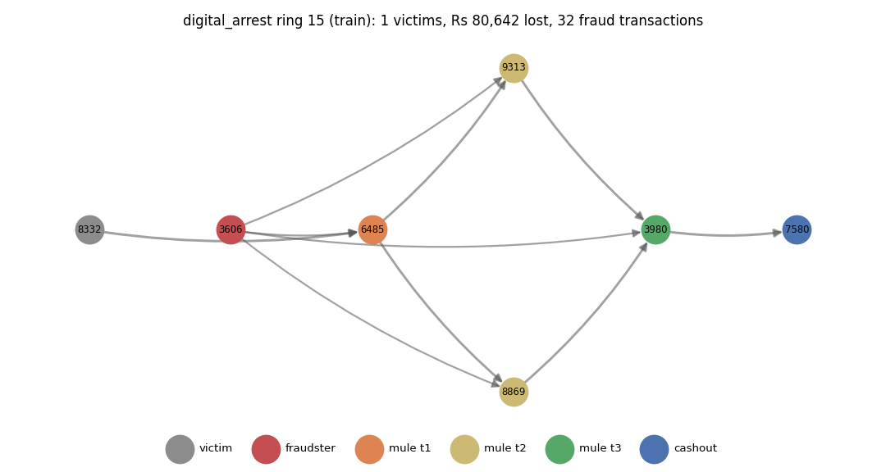
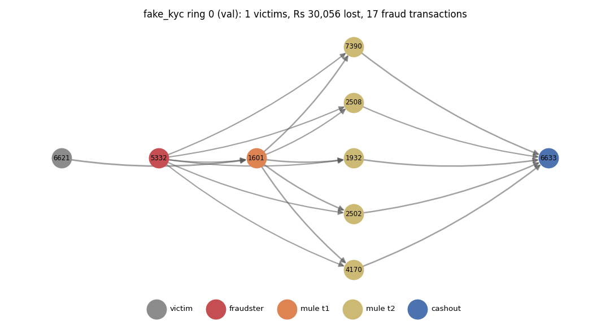
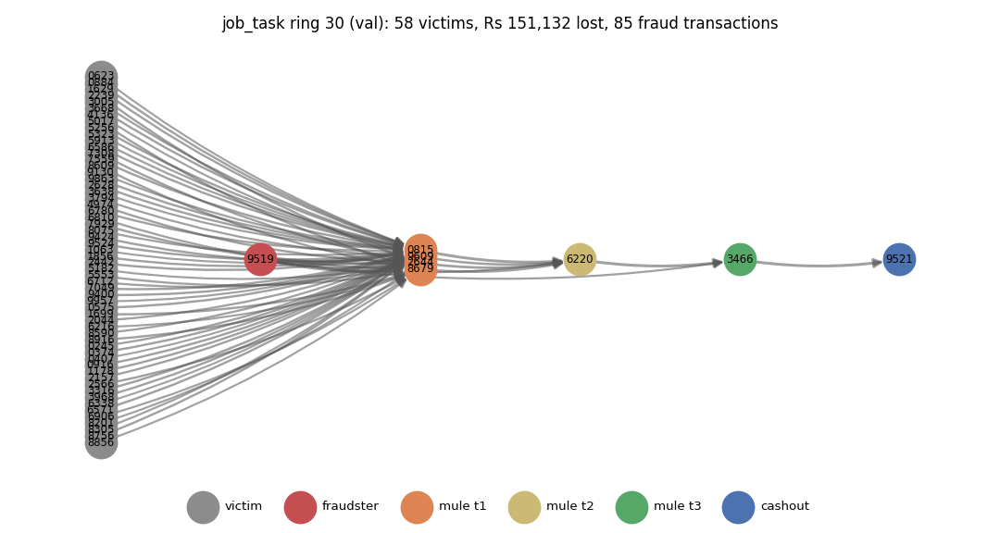
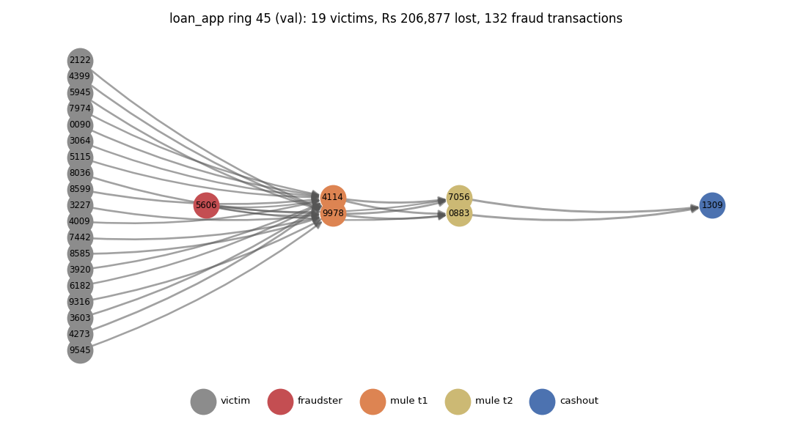
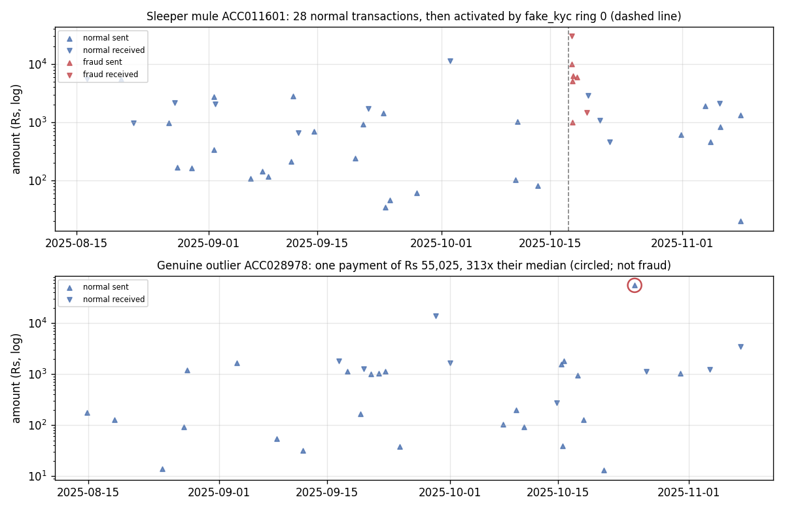
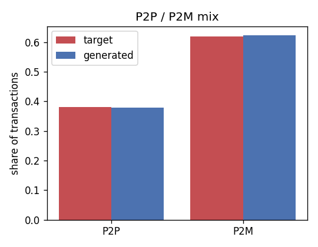
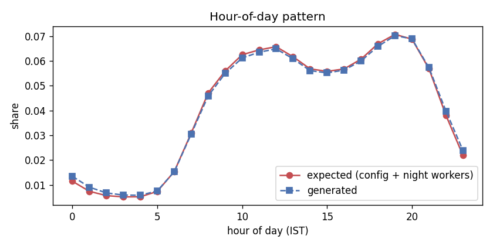
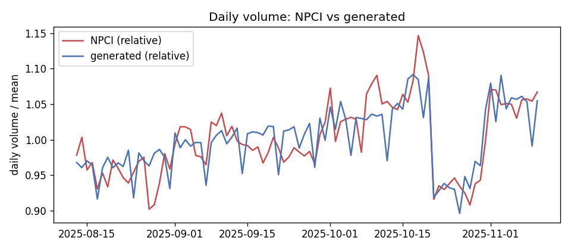

# Simulator and data validation (Person A)

## Why simulated data

Real transaction data is legally unavailable; we built a simulator calibrated to NPCI/RBI statistics and validated against the IBM AML benchmark.

## Regenerating

```bash
python -m simulator.generate --config simulator/config.yaml --out data/generated
python -m simulator.validate
```

The output is identical for the same seed and the pinned `requirements.txt`; compare with `data/generated/CHECKSUMS.txt`.

## Dataset summary

| item | value |
|---|---|
| Window | 2025-08-13 to 2025-11-10 (90 days) |
| Accounts | 50,377 |
| Transactions | 1,803,905 |
| Fraud rings | 75 |
| Fraud accounts (true role) | 605 (1.20%) |
| Fraud labels in accounts.csv (with noise) | 605 (1.20%) |
| Fraud transactions | 7,347 (0.407%) |
| Victims | 1,186 |

Accounts by true role:

| role | accounts |
|---|---|
| normal | 36086 |
| merchant | 12500 |
| victim | 1186 |
| mule_t2 | 214 |
| mule_t1 | 170 |
| cashout | 75 |
| fraudster | 75 |
| mule_t3 | 71 |

## The five scam scenarios

One row per scenario. Across all scenarios a victim loses Rs 10,032 on average, against the Lok Sabha FY2024-25 average of Rs 7,761 per reported incident. The scenarios differ on purpose: a digital-arrest victim pays several large instalments, a job-task victim a few small fees.

| scenario | rings | evasive_rings | fraud_accounts | victims | fraud_txns | mean_loss_per_victim_rs |
|---|---|---|---|---|---|---|
| digital_arrest | 15 | 6 | 118 | 15 | 1200 | 137,675 |
| fake_investment | 15 | 9 | 125 | 176 | 1783 | 22,713 |
| fake_kyc | 15 | 7 | 122 | 15 | 289 | 30,086 |
| job_task | 15 | 0 | 125 | 583 | 1275 | 2,679 |
| loan_app | 15 | 0 | 115 | 397 | 2800 | 9,629 |

## Config and calibration sources

Every number lives in `simulator/config.yaml` with its source beside it. 77 values; 65 are marked `assumed`: design choices from the plan, or values with no public source. They are listed so the report can say so honestly:

`seed`, `window.start`, `splits.shares`, `splits.lookback_days`, `splits.new_counterparty_history_days`, `splits.ring_tail_days`, `population.n_accounts`, `population.small_n_accounts`, `population.type_mix`, `population.new_account_share`, `population.shared_device_household_share`, `population.family_size`, `bank_mix`, `state_mix`, `ticket_size.p2m`, `ticket_size.p2p_family`, `ticket_size.bills`, `ticket_size.rent`, `ticket_size.salary`, `ticket_size.gig_payout`, `ticket_size.supplier`, `channel_mix`, `hour_of_day`, `behaviours.salaried`, `behaviours.student`, `behaviours.gig_worker`, `behaviours.small_merchant`, `behaviours.large_merchant`, `behaviours.salary_via_upi_share`, `behaviours.merchant_size_weight`, `behaviours.phone_change_share`, `hard_cases.money_collector_share`, `hard_cases.collections_per_month`, `hard_cases.collection_size`, `hard_cases.collection_amount`, `hard_cases.forward_share`, `hard_cases.forward_delay`, `hard_cases.shop_phone_group_share`, `hard_cases.shop_phone_group_size`, `hard_cases.new_account_large_receipt_share`, `hard_cases.new_account_large_receipt_days`, `hard_cases.new_account_large_receipt_amount`, `hard_cases.night_worker_share`, `hard_cases.night_shift_hours`, `outliers.account_rate`, `outliers.multiplier`, `fraud.rings_per_scenario`, `fraud.small_rings_per_scenario`, `fraud.ring_size`, `fraud.max_ring_days`, `fraud.sleeper_share`, `fraud.sleeper_min_history_days`, `fraud.fresh_mule_age_days`, `fraud.threshold_split_share`, `fraud.threshold_band`, `fraud.hop_delay`, `fraud.mule_commission`, `fraud.mule_devices_per_ring`, `fraud.patient_mule_share`, `fraud.patient_delay_h`, `scenarios.fake_kyc`, `scenarios.digital_arrest`, `scenarios.job_task`, `scenarios.loan_app`, `scenarios.fake_investment`

| key | value | status | source |
|---|---|---|---|
| seed | 42 | assumed | assumed: fixed seed for reproducibility |
| window.start | 2025-08-13 | assumed | plan D5 (our choice): 90-day window covering Dussehra (day 51) and Diwali (day 69), with NPCI data for the same months |
| window.days | 90 | sourced | handoff §4.1: about 90 days |
| splits.train | [1, 60] | sourced | handoff §6: train = days 1-60 |
| splits.val | [61, 75] | sourced | handoff §6: validation = days 61-75 |
| splits.test | [76, 90] | sourced | handoff §6: test = days 76-90 |
| splits.shares | {"train": 0.5, "val": 0.25, "test": 0.25} | assumed | plan D7/D8: rings and normal accounts split 50/25/25 |
| splits.lookback_days | 30 | assumed | plan D8: features use a 30-day window ending on the split's last day |
| splits.new_counterparty_history_days | 30 | assumed | plan rev 2: fixed 30-day history for new_counterparty_share |
| splits.ring_tail_days | 6 | assumed | plan D8 / rev 4: rings start at least 6 days before their split ends, leaving room for patient hops |
| population.n_accounts | 50000 | assumed | plan D6, inside handoff §4.1 range of 20k-50k |
| population.small_n_accounts | 5000 | assumed | plan D6: --small config for development and tests |
| population.type_mix | {"salaried": 0.42, "student": 0.18, "gig_worker": 0.15, "... | assumed | assumed: no public split of UPI users by occupation; merchants about a quarter of accounts |
| population.new_account_share | 0.08 | assumed | plan D24: normal accounts opened during the window, so being new is not unique to mules |
| population.shared_device_household_share | 0.04 | assumed | plan D24: households sharing one phone, so device sharing is not unique to mules |
| population.family_size | [1, 4] | assumed | assumed: 1-4 family accounts per user for P2P transfers |
| bank_mix | {"SBI": 0.3, "HDFC": 0.18, "ICICI": 0.15, "Axis": 0.1, "P... | assumed | assumed: bank list and market-share weighting idea from the Kaggle synthetic 'UPI Transactions 2024' dataset (secondary, design idea only) |
| state_mix | {"Maharashtra": 0.16, "Uttar Pradesh": 0.14, "Karnataka":... | assumed | assumed: state list from the Kaggle synthetic UPI dataset (secondary); weights roughly by population and digital adoption |
| ticket_size.target_mean_inr | 1280 | sourced | NPCI UPI daily statistics, 13 Aug - 10 Nov 2025: total value / total volume = Rs 1,280 (data/raw/npci/upi_daily_2025-08_to_2025-11.csv) |
| ticket_size.p2m | {"median": 120, "sigma": 1.0} | assumed | assumed; tuned with bills so that about 86% of all P2M payments are <= Rs 500 (secondary: Outlook Money, Feb 2025) |
| ticket_size.p2p_family | {"median": 1600, "sigma": 0.9} | assumed | assumed |
| ticket_size.bills | {"median": 350, "sigma": 0.7} | assumed | assumed: bills and mobile recharges |
| ticket_size.rent | {"median": 8000, "sigma": 0.5} | assumed | assumed |
| ticket_size.salary | {"median": 15000, "sigma": 0.5} | assumed | assumed: wages paid over UPI come mostly from small employers (shops, domestic work); corporate salaries use NEFT |
| ticket_size.gig_payout | {"median": 2000, "sigma": 0.6} | assumed | assumed: weekly gig-platform payouts |
| ticket_size.supplier | {"median": 4000, "sigma": 0.8} | assumed | assumed: merchant payments to suppliers |
| channel_mix | {"P2P": 0.38, "P2M": 0.62} | assumed | secondary, not NPCI: Outlook Money (FY2024-25 to Jan 2025) reports 62.35% P2M by volume; Meetanshi (Feb 2026, citing NPCI) 62.4%. NPCI's ecosystem statistics page was unavailable on 2026-10-27 (API 503/403) |
| hour_of_day | [0.8, 0.4, 0.25, 0.2, 0.2, 0.4, 1.2, 2.8, 4.5, 5.5, 6.3, ... | assumed | assumed: NPCI publishes no hour-of-day data; daytime plateau with an evening peak and a night trough |
| weekend.volume_uplift | 0.0 | sourced | NPCI daily statistics Aug-Nov 2025: Saturday/Sunday volume within 1.2% of the weekly mean |
| weekend.sunday_value_factor | 0.83 | sourced | NPCI daily statistics Aug-Nov 2025: Sunday value = 0.832 x mean daily value |
| month_start.value_uplift_days_1_5 | 0.17 | sourced | NPCI daily statistics Aug-Nov 2025: value on days 1-5 = 1.167 x other days (salary and rent week); validation target |
| festivals | [{"name": "Dussehra", "start": "2025-10-02", "end": "2025... | sourced | NPCI daily statistics: 16-20 Oct volume +4.7% and 21-30 Oct -11.3% vs 6-15 Oct; 2 Oct +0.3% vs 22 Sep-1 Oct but -3.0% vs 3-5 Oct (a public holiday inside the month-start week, so the simulator applies -3%). Diwali 20 Oct 2025 (Tribune India); Dhanteras 18 Oct = NPCI's busiest day in the window. Dussehra date to verify against an official holiday list |
| behaviours.salaried | {"p2m_per_day": 0.3, "p2p_per_day": 0.1, "bills_per_month... | assumed | assumed; rates tuned so the default config gives about 1.5M transactions (plan D6) with the NPCI mean ticket |
| behaviours.student | {"p2m_per_day": 0.22, "p2p_per_day": 0.08, "bills_per_mon... | assumed | assumed |
| behaviours.gig_worker | {"p2m_per_day": 0.26, "p2p_per_day": 0.12, "bills_per_mon... | assumed | assumed; weekly platform payouts |
| behaviours.small_merchant | {"p2m_per_day": 0.06, "p2p_per_day": 0.08, "supplier_per_... | assumed | assumed: merchants mostly receive |
| behaviours.large_merchant | {"p2m_per_day": 0.03, "p2p_per_day": 0.02, "supplier_per_... | assumed | assumed; large merchants also pay salaries and gig payouts (plan D13) |
| behaviours.salary_via_upi_share | 0.05 | assumed | assumed: most salaries arrive by NEFT/IMPS, not UPI; only these salary credits appear in UPI data |
| behaviours.merchant_size_weight | {"small_merchant": 1.0, "large_merchant": 8.0} | assumed | assumed: large merchants receive about 8x the P2M payments of small ones |
| behaviours.phone_change_share | 0.02 | assumed | assumed: accounts that change phone once mid-window |
| hard_cases.money_collector_share | 0.05 | assumed | assumed: people who collect money from several others and pass it on the same day (group funds, family pooling, informal agents) |
| hard_cases.collections_per_month | 4 | assumed | assumed |
| hard_cases.collection_size | [3, 8] | assumed | assumed: payers per collection |
| hard_cases.collection_amount | {"median": 1500, "sigma": 0.8} | assumed | assumed |
| hard_cases.forward_share | [0.85, 1.0] | assumed | assumed: share of the collected money passed on |
| hard_cases.forward_delay | {"median_h": 3.0, "sigma": 0.8} | assumed | assumed: hours before passing the money on |
| hard_cases.shop_phone_group_share | 0.05 | assumed | assumed: small shops where the owner and staff pay from one phone |
| hard_cases.shop_phone_group_size | [3, 6] | assumed | assumed: accounts per shared shop phone (the shop plus 2-5 staff) |
| hard_cases.new_account_large_receipt_share | 0.4 | assumed | assumed: new accounts whose first large receipt is a first salary, fees or a family transfer |
| hard_cases.new_account_large_receipt_days | [1, 20] | assumed | assumed: days after opening |
| hard_cases.new_account_large_receipt_amount | [10000, 60000] | assumed | assumed |
| hard_cases.night_worker_share | 0.3 | assumed | assumed: gig workers on night shifts (delivery, ride-hailing) |
| hard_cases.night_shift_hours | 12 | assumed | assumed: their hour-of-day curve is shifted by 12 hours |
| outliers.account_rate | 0.01 | assumed | assumed: genuine one-off spikes (wedding, hospital bill, phone purchase) |
| outliers.multiplier | [10, 40] | assumed | assumed: outlier amount = 10-40x the account's median |
| fraud.rings_per_scenario | 15 | assumed | plan D7 (review rev 2) |
| fraud.small_rings_per_scenario | 4 | assumed | assumed: --small development config (5,000 accounts) keeps the fraud share moderate |
| fraud.ring_size | {"mule_t1": [2, 4], "mule_t2": [1, 3], "mule_t3": [0, 2],... | assumed | plan D7: about 8 accounts per ring with the fraudster |
| fraud.max_ring_days | 8 | assumed | plan D8: rings fit inside the 15-day val/test periods |
| fraud.sleeper_share | 0.5 | assumed | plan D14 / handoff §4.5 sleeper mules; raised to 0.50 in plan rev 4 (many mules are recruited existing accounts) |
| fraud.sleeper_min_history_days | 21 | assumed | plan D14 |
| fraud.fresh_mule_age_days | [3, 20] | assumed | plan D14: fresh mules opened 3-20 days before the ring |
| fraud.threshold_split_share | 0.3 | assumed | plan D14 |
| fraud.thresholds | [10000, 25000, 50000] | sourced | handoff §4.3: Person B's minimax thresholds |
| fraud.threshold_band | [0.9, 0.999] | assumed | plan D12/D14: same band as the below_threshold feature |
| fraud.hop_delay | {"median_h": 2.0, "sigma": 1.5, "cap_h": 48} | assumed | plan D14 (rev 2): about 95% of hops within 24 h; Person B's 48 h hop rule |
| fraud.mule_commission | [0.92, 0.99] | assumed | plan Task 5: each mule forwards 92-99% of what it received |
| fraud.mule_devices_per_ring | [2, 4] | assumed | plan rev 4: fresh mules and the fraudster spread over 2-4 ring phones (fewer accounts per phone); sleepers use their own |
| fraud.patient_mule_share | 0.3 | assumed | plan rev 4: about 30% of mules wait before forwarding (hard case for pass-through) |
| fraud.patient_delay_h | [24, 47] | assumed | plan rev 4: patient mules wait 1-2 days, kept inside Person B's 48 h hop window |
| label_noise.rate | 0.015 | sourced | handoff §4.5: about 1-2% label noise; plan D9 keeps prevalence |
| scenarios.fake_kyc | {"victims": [1, 1], "payments_per_victim": [1, 1], "amoun... | assumed | handoff §4.3 shape; amounts assumed, scaled (plan rev 4) so the average loss per victim is near the Lok Sabha Rs 7,761 per incident |
| scenarios.digital_arrest | {"victims": [1, 1], "payments_per_victim": [3, 8], "amoun... | assumed | handoff §4.3 shape; amounts assumed, scaled (plan rev 4) so the average loss per victim is near the Lok Sabha Rs 7,761 per incident |
| scenarios.job_task | {"victims": [15, 60], "payments_per_victim": [1, 1], "amo... | assumed | handoff §4.3 shape; amounts assumed, scaled (plan rev 4) so the average loss per victim is near the Lok Sabha Rs 7,761 per incident |
| scenarios.loan_app | {"victims": [10, 40], "payments_per_victim": [2, 5], "amo... | assumed | handoff §4.3 shape; amounts assumed, scaled (plan rev 4) so the average loss per victim is near the Lok Sabha Rs 7,761 per incident |
| scenarios.fake_investment | {"victims": [5, 20], "returns_per_victim": [1, 3], "retur... | assumed | handoff §4.3 shape; amounts assumed, scaled (plan rev 4) so the average loss per victim is near the Lok Sabha Rs 7,761 per incident |
| scenarios.avg_loss_check_inr | 7761 | sourced | Lok Sabha Unstarred Q 2481 (15 Dec 2025): FY2024-25 Rs 981 crore / 12.64 lakh incidents = Rs 7,761 per incident; sanity check for victim amounts |

## Toy data

`python -m simulator.make_toy_data --out data/generated/toy` writes a tiny dataset with the same columns, for Person B to build against without the real data. When `data/generated/accounts.csv` is missing, code falls back to it (CONTRACTS.md). It holds 500 accounts and 3,016 transactions and is committed to git.

## Example rings and mule patterns

One ring per scenario, money flowing left to right. Node labels are the last four digits of the account id; edge width grows with the amount.

**digital_arrest**



**fake_investment**


**fake_kyc**



**job_task**



**loan_app**



## Noise

- **Sleeper mule** (top panel): `ACC011601` made 28 ordinary transactions before fake_kyc ring 0 used it. 50% of mules are sleepers like this (accounts at least 21 days old when their ring starts), and they send from their own phones, so age and device features alone cannot find them.
- **Genuine outlier** (bottom panel): `ACC028978` is an ordinary user who once paid Rs 55,025, 313x their median payment (a wedding, a hospital bill, a phone). It is labelled 0, so a model must not flag every spike.
- **Label noise:** in `accounts.csv`, 9 fraud accounts are labelled 0 and 9 non-fraud accounts are labelled 1 (D9). `role` and `transactions.csv` stay clean, so validity checks use the true role.
- **Threshold splitting:** 22 of 75 rings split victim payments to 90-99.9% of Rs 10k / 25k / 50k.

| true role | label 0 | label 1 |
|---|---|---|
| fraud role | 9 | 596 |
| not fraud role | 49763 | 9 |



## Validation (handoff §5.3)

| check | target | generated | gap | passed | source |
|---|---|---|---|---|---|
| mean_ticket_inr | 1280 | 1,352 | 71.89 | PASS | NPCI daily statistics Aug-Nov 2025 (tolerance ±15%) |
| p2m_share | 0.62 | 0.6231 | 0.003072 | PASS | secondary (Outlook Money); tolerance ±3 pp |
| p2m_share_le_500 | 0.86 | 0.8844 | 0.02442 | PASS | secondary (Outlook Money); tolerance ±5 pp |
| hour_of_day_tvd | 0 | 0.01041 | 0.01041 | PASS | assumed hour curve blended with night workers; total variation distance <= 0.05 |
| night_share_23_to_05 | 0.05703 | 0.06496 | 0.007923 | PASS | assumed hour curve blended with night workers; tolerance ±2 pp |
| weekend_volume_factor | 1 | 0.9866 | -0.01341 | PASS | NPCI daily statistics; tolerance ±0.05 |
| sunday_value_factor | 0.83 | 0.8097 | -0.02027 | PASS | NPCI daily statistics; tolerance ±0.05 |
| month_start_value_factor | 1.17 | 1.195 | 0.0248 | PASS | NPCI daily statistics; tolerance ±0.15 |
| festival_Dussehra | 0.003 | 0.004757 | 0.001757 | PASS | NPCI daily statistics vs 2025-09-22..2025-10-01; tolerance ±3 pp |
| festival_Dhanteras-Diwali | 0.047 | 0.04445 | -0.002546 | PASS | NPCI daily statistics vs 2025-10-06..2025-10-15; tolerance ±3 pp |
| festival_post-Diwali | -0.113 | -0.09175 | 0.02125 | PASS | NPCI daily statistics vs 2025-10-06..2025-10-15; tolerance ±3 pp |
| txn_fraud_share | < 0.01 | 0.004073 | — | PASS | handoff §4.7 |
| account_fraud_share | 0.008 - 0.018 | 0.01201 | — | PASS | plan D7 |
| fraud_txns_fake_kyc | > 0 | 289 | — | PASS | handoff §4.3 |
| fraud_txns_digital_arrest | > 0 | 1,200 | — | PASS | handoff §4.3 |
| fraud_txns_job_task | > 0 | 1,275 | — | PASS | handoff §4.3 |
| fraud_txns_loan_app | > 0 | 2,800 | — | PASS | handoff §4.3 |
| fraud_txns_fake_investment | > 0 | 1,783 | — | PASS | handoff §4.3 |
| avg_victim_loss_inr | 7761 | 10,032 | 2,271 | — | Lok Sabha AU2481 per-incident average; information only |









Check 6 (models must not score near 100%) needs the trained models, so it is reported in `a_05_classifiers.md` under "Shortcut check".

## Laundering patterns and the IBM AML check

Pattern counts in our fraud transactions (48 h windows):

| pattern | fraud graph | whole graph (fan/chain only) |
|---|---|---|
| fan_out | 147 | 44,264 |
| fan_in | 238 | 21,783 |
| chain | 3531 | 814,491 |
| scatter_gather | 126 | — |
| cycle | 4 | — |

Structure check against IBM AML HI-Small (D20): PASS means every IBM pattern type we implement appears in our graph. The mix is shown but not judged, because our own config sets it.

| ibm_pattern | our_pattern | ibm_count | ibm_share | our_count | our_share | status |
|---|---|---|---|---|---|---|
| BIPARTITE |  | 49 | 0.1324 | — | — | not implemented |
| CYCLE | cycle | 54 | 0.1459 | 4 | 0.0009886 | PASS |
| FAN-IN | fan_in | 40 | 0.1081 | 238 | 0.05882 | PASS |
| FAN-OUT | fan_out | 48 | 0.1297 | 147 | 0.03633 | PASS |
| GATHER-SCATTER |  | 51 | 0.1378 | — | — | not implemented |
| RANDOM |  | 41 | 0.1108 | — | — | not implemented |
| SCATTER-GATHER | scatter_gather | 44 | 0.1189 | 126 | 0.03114 | PASS |
| STACK |  | 43 | 0.1162 | — | — | not implemented |
| chain (ours only) | chain | — | — | 3,531 | 0.8727 | ours only |
