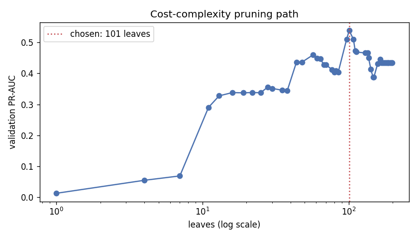
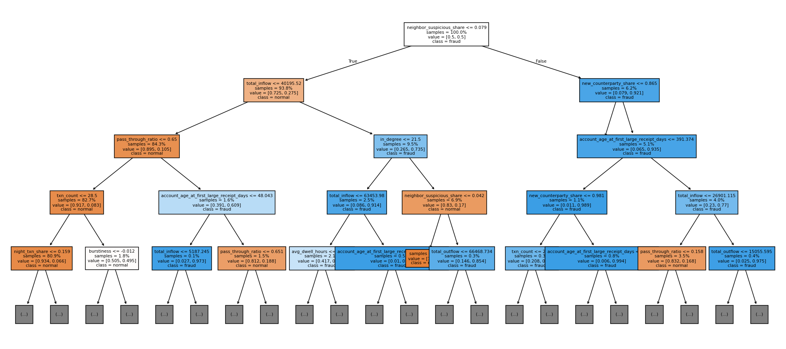
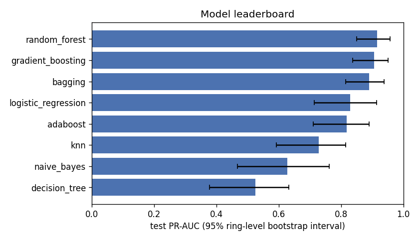

# Supervised fraud models (Person A)

## Why not accuracy

Only 1.34% of test accounts are fraud. A model that always says "not fraud" is 98.7% accurate and catches nobody, so accuracy is never a headline here. We report precision, recall, F1, PR-AUC and recall at a 1% false-alarm rate. Precision matters because wrongly freezing a genuine user's account causes real harm.

| model | accuracy | precision | recall | f1 | pr_auc |
|---|---|---|---|---|---|
| always 'not fraud' | 0.9866 | 0 | 0 | 0 | 0.01343 |
| random_forest | 0.9963 | 0.9624 | 0.7529 | 0.8449 | 0.9151 |

## Features

One row per account, computed only from that account's transactions inside its split's 30-day window. No feature reads `role`, `is_fraud` or `scenario`.

| feature | family | definition |
|---|---|---|
| `total_inflow` | flow | Rupees received in the window |
| `total_outflow` | flow | Rupees sent in the window |
| `pass_through_ratio` | flow | Rupees sent on within 24 h of arriving / rupees received (FIFO matching, each rupee once) |
| `avg_dwell_hours` | flow | Amount-weighted hours money stays before it is sent on; unsent money counts until window end |
| `in_degree` | network | Distinct accounts that sent money to this account |
| `out_degree` | network | Distinct accounts this account sent money to |
| `new_counterparty_share` | network | Share of counterparties not seen in the 30 days before the window |
| `fan_in_max_24h` | network | Most distinct senders within any 24 h |
| `fan_out_max_24h` | network | Most distinct receivers within any 24 h |
| `neighbor_suspicious_share` | network | Share of counterparties whose own pass-through is >= 0.8 (label-free) |
| `txn_count` | behavioural | Transactions sent or received |
| `night_txn_share` | behavioural | Share of transactions between 23:00 and 04:59 IST |
| `round_amount_share` | behavioural | Share of amounts >= Rs 1,000 that are a multiple of Rs 500 |
| `below_threshold_share` | behavioural | Share of amounts in [90%, 100%) of Rs 10k / 25k / 50k |
| `burstiness` | behavioural | (sd - mean) / (sd + mean) of gaps between transactions; 0 with fewer than 3 |
| `has_large_receipt` | behavioural | 1 if the account received a single payment >= Rs 10,000 |
| `account_age_at_first_large_receipt_days` | behavioural | Account age in days at its first receipt >= Rs 10,000 (age at window end if none) |
| `device_count` | device_location | Distinct devices the account sent from |
| `device_shared_accounts` | device_location | Other accounts that sent from any of the same devices |
| `counterparty_state_mismatch_share` | device_location | Share of counterparties registered in a different state |

## Leakage-safe split


| split | split days | feature window days | accounts | positives | rings |
|---|---|---|---|---|---|
| train | 1-60 | 31-60 | 25098 | 278 | 35 |
| val | 61-75 | 46-75 | 12619 | 157 | 20 |
| test | 76-90 | 61-90 | 12660 | 170 | 20 |

- Each fraud ring, with all its members, is in exactly one split; so is each normal account.
- SMOTE runs inside the training pipeline only, never on validation or test rows.
- `neighbor_suspicious_share` uses counterparties' pass-through, not their labels.
- Thresholds and hyperparameters are chosen on validation; test is used once, for the leaderboard.
- Train risk scores are out-of-fold, with each ring kept inside one fold.

## Decision tree: overfitting curve, Gini vs entropy


Training PR-AUC keeps rising with depth while validation peaks: best validation PR-AUC 0.514 at depth 8 with Gini, 0.656 at depth 9 with entropy, so entropy splits better here. Deeper trees only memorise the training accounts.

| depth | train_pr_auc | val_pr_auc | train_pr_auc_entropy | val_pr_auc_entropy |
|---|---|---|---|---|
| 1 | 0.06334 | 0.03709 | 0.06334 | 0.03709 |
| 2 | 0.2303 | 0.1347 | 0.2288 | 0.1345 |
| 3 | 0.3144 | 0.2172 | 0.3915 | 0.2876 |
| 4 | 0.4245 | 0.308 | 0.5638 | 0.4574 |
| 5 | 0.5584 | 0.4369 | 0.6857 | 0.5327 |
| 6 | 0.6695 | 0.4802 | 0.7908 | 0.5651 |
| 7 | 0.7212 | 0.4595 | 0.8655 | 0.6347 |
| 8 | 0.8265 | 0.5143 | 0.9199 | 0.6443 |
| 9 | 0.8679 | 0.4678 | 0.9525 | 0.6562 |
| 10 | 0.8889 | 0.4607 | 0.9762 | 0.6139 |
| 11 | 0.9238 | 0.4436 | 0.99 | 0.5954 |
| 12 | 0.9541 | 0.4797 | 0.9954 | 0.5905 |
| 13 | 0.9681 | 0.4349 | 0.9971 | 0.5882 |
| 14 | 0.9751 | 0.4178 | 0.9978 | 0.5485 |
| 15 | 0.9771 | 0.4159 | 0.998 | 0.4975 |
| 16 | 0.9791 | 0.442 | 0.998 | 0.5108 |
| 17 | 0.9899 | 0.4531 | 0.998 | 0.5108 |
| 18 | 0.9944 | 0.4393 | 0.998 | 0.5108 |
| 19 | 0.9963 | 0.4359 | 0.998 | 0.5108 |
| 20 | 0.9971 | 0.4339 | 0.998 | 0.5108 |

## Decision tree: cost-complexity pruning and the mule rulebook



Best validation PR-AUC 0.539 with 101 leaves (alpha = 1.19e-04).



The pruned tree as rules, first 3 levels (the full rulebook is `reports/a_tables/tree_rules.txt`). Each line is an attribute test condition:

```text
|--- neighbor_suspicious_share <= 0.079
|   |--- total_inflow <= 26092.520
|   |   |--- txn_count <= 7.500
|   |   |--- txn_count >  7.500
|   |--- total_inflow >  26092.520
|   |   |--- in_degree <= 41.500
|   |   |--- in_degree >  41.500
|--- neighbor_suspicious_share >  0.079
|   |--- account_age_at_first_large_receipt_days <= 391.374
|   |   |--- new_counterparty_share <= 0.868
|   |   |--- new_counterparty_share >  0.868
|   |--- account_age_at_first_large_receipt_days >  391.374
|   |   |--- txn_count <= 30.500
|   |   |--- txn_count >  30.500
```

## Class imbalance

Logistic regression with no handling, balanced class weights and SMOTE (training rows only). The other models use balanced class weights, except KNN (SMOTE) and Naive Bayes (priors from the data) (D15).

| method | val_pr_auc | test_pr_auc | test_precision | test_recall | test_f1 | test_recall_at_1pct_fpr |
|---|---|---|---|---|---|---|
| none | 0.7782 | 0.8418 | 0.8966 | 0.7647 | 0.8254 | 0.8647 |
| class_weight | 0.756 | 0.8322 | 0.9462 | 0.7235 | 0.82 | 0.8471 |
| smote | 0.7477 | 0.8188 | 0.9528 | 0.7118 | 0.8148 | 0.8353 |

On validation PR-AUC, `none` is best for logistic regression. PR-AUC only measures ranking, and re-weighting mostly shifts the scores; the decision threshold is tuned on validation anyway, so imbalance handling matters less here than its reputation suggests.

## Leaderboard (test split)

All eight models, same features, same splits. Hyperparameters and the decision threshold (best F1) are chosen on validation. The 95% interval resamples whole rings, because ring-mates are correlated.

| model | pr_auc | pr_auc_95ci | precision | recall | f1 | recall_at_1pct_fpr | threshold | params |
|---|---|---|---|---|---|---|---|---|
| random_forest | 0.9151 | 0.850-0.957 | 0.9624 | 0.7529 | 0.8449 | 0.9176 | 0.4844 | {'model__max_depth': 12, 'model__min_samples_leaf': 5} |
| gradient_boosting | 0.9065 | 0.838-0.951 | 0.9615 | 0.7353 | 0.8333 | 0.9294 | 0.9394 | {'model__learning_rate': 0.1, 'model__max_leaf_nodes': 15} |
| bagging | 0.8896 | 0.815-0.938 | 0.9237 | 0.7118 | 0.804 | 0.9059 | 0.4 | {'model__estimator__max_depth': None} |
| logistic_regression | 0.8295 | 0.713-0.914 | 0.9444 | 0.7 | 0.8041 | 0.8471 | 0.9924 | {'model__C': 10.0} |
| adaboost | 0.8177 | 0.710-0.890 | 0.9153 | 0.6353 | 0.75 | 0.8529 | 0.7844 | {'model__estimator__max_depth': 3, 'model__learning_rate': 0.5} |
| knn | 0.7277 | 0.592-0.815 | 0.8797 | 0.6882 | 0.7723 | 0.8 | 1 | {'model__n_neighbors': 31} |
| naive_bayes | 0.6275 | 0.468-0.763 | 0.819 | 0.5588 | 0.6643 | 0.6765 | 0.3707 | {'model__var_smoothing': 1e-09} |
| decision_tree | 0.5256 | 0.379-0.632 | 0.6387 | 0.7176 | 0.6759 | 0.7353 | 0.9879 | {'model__max_depth': 8} |




Naive Bayes assumes features are independent given the class. Flow features are strongly correlated (inflow, outflow, pass-through, dwell), so it counts the same evidence several times and ranks poorly.

## Shortcut check (handoff §5.3 check 6)

**PASS.** The best single feature reaches validation PR-AUC 0.211 on its own (gate 0.9) and the best model 0.915 on test (gate 0.98).

| feature | val_pr_auc |
|---|---|
| neighbor_suspicious_share | 0.2109 |
| total_inflow | 0.1812 |
| burstiness | 0.163 |
| total_outflow | 0.1317 |
| night_txn_share | 0.1083 |
| pass_through_ratio | 0.08467 |
| below_threshold_share | 0.08317 |
| fan_out_max_24h | 0.07756 |
| account_age_at_first_large_receipt_days | 0.07446 |
| avg_dwell_hours | 0.0638 |

## Logistic regression coefficients as risk factors

Standardised features, so coefficients are comparable. An odds ratio above 1 raises the fraud risk.

| feature | coefficient | odds_ratio |
|---|---|---|
| in_degree | -15.34 | 2.18e-07 |
| txn_count | 11.45 | 93,739 |
| out_degree | -3.106 | 0.04478 |
| total_inflow | 1.294 | 3.649 |
| new_counterparty_share | 1.292 | 3.642 |
| neighbor_suspicious_share | 1.056 | 2.876 |
| device_count | -1.038 | 0.3543 |
| pass_through_ratio | 0.6856 | 1.985 |
| account_age_at_first_large_receipt_days | -0.578 | 0.561 |
| fan_out_max_24h | 0.5565 | 1.745 |
| counterparty_state_mismatch_share | -0.4341 | 0.6478 |
| fan_in_max_24h | 0.3564 | 1.428 |
| total_outflow | 0.3286 | 1.389 |
| round_amount_share | -0.1858 | 0.8305 |
| has_large_receipt | -0.1089 | 0.8969 |
| device_shared_accounts | 0.0996 | 1.105 |
| burstiness | -0.09919 | 0.9056 |
| night_txn_share | 0.09129 | 1.096 |
| below_threshold_share | 0.08974 | 1.094 |
| avg_dwell_hours | 0.06185 | 1.064 |

`in_degree` and `txn_count` are 0.97 correlated, so the model gives them large weights of opposite sign that mostly cancel: read them together, not as two separate risk factors. That is collinearity, and it is why the tree models are used for explanations.

## Ablation: what network features add

Adding the six network features changes test PR-AUC by +0.086 (random forest).

| features | n_features | test_pr_auc | test_f1 | test_recall_at_1pct_fpr |
|---|---|---|---|---|
| transaction_only | 14 | 0.8348 | 0.7883 | 0.8353 |
| with_network | 20 | 0.9208 | 0.8862 | 0.9412 |

Both rows use the random forest's default settings, without the validation grid, so the with-network row differs slightly from the leaderboard (0.915); the comparison between the rows is fair.

## Per-scenario results

Recall of the best model on each scam's fraud accounts in test.

| scenario | n_fraud | recall | mean_risk_prob |
|---|---|---|---|
| fake_kyc | 35 | 0.3714 | 0.4719 |
| job_task | 30 | 0.7 | 0.642 |
| digital_arrest | 35 | 0.8571 | 0.7554 |
| fake_investment | 33 | 0.9394 | 0.8178 |
| loan_app | 35 | 0.9429 | 0.8264 |

Weakest: `fake_kyc` (recall 0.37); strongest: `loan_app` (0.94). Each row rests on only 30-35 fraud accounts, so gaps of a few points are noise.

## Handoff files

`models/risk_scores.csv`: 50,377 accounts from `random_forest`, clipped to [1e-6, 1 - 1e-6] for Person B's A* cost. Train rows are out-of-fold, so their PR-AUC is not better than test:

| split | accounts | pr_auc_of_risk_prob |
|---|---|---|
| train | 25098 | 0.8494 |
| val | 12619 | 0.866 |
| test | 12660 | 0.9151 |

Saved models (load with `mulehunt.models.load_model`, see CONTRACTS.md §5):

| file | size_kb |
|---|---|
| `models/adaboost.joblib` | 8 |
| `models/bagging.joblib` | 685 |
| `models/decision_tree.joblib` | 7 |
| `models/gradient_boosting.joblib` | 56 |
| `models/knn.joblib` | 4247 |
| `models/logistic_regression.joblib` | 2 |
| `models/naive_bayes.joblib` | 2 |
| `models/random_forest.joblib` | 1937 |
