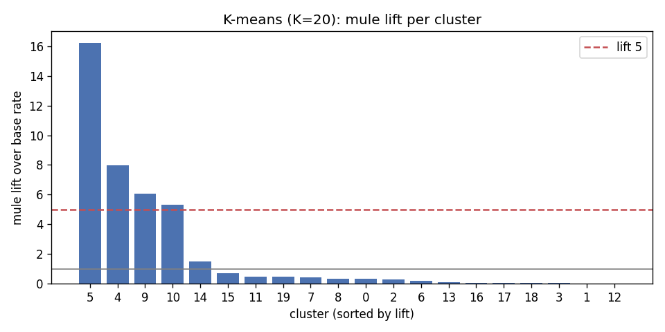
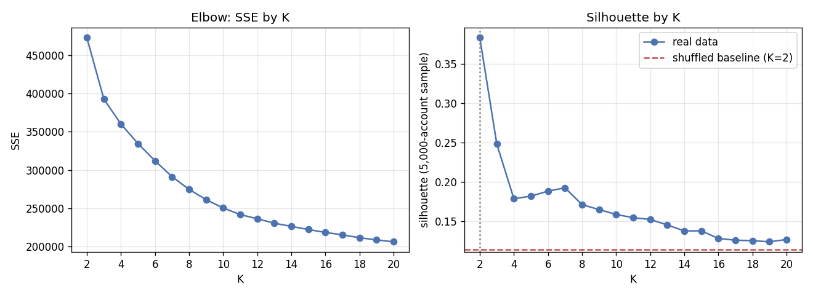
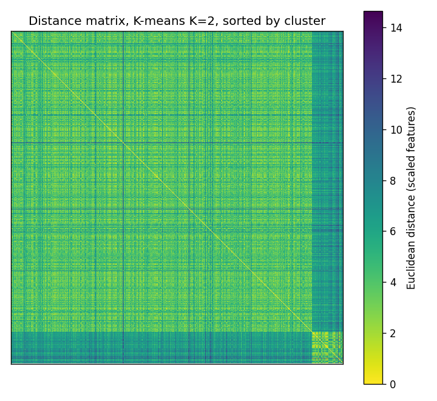
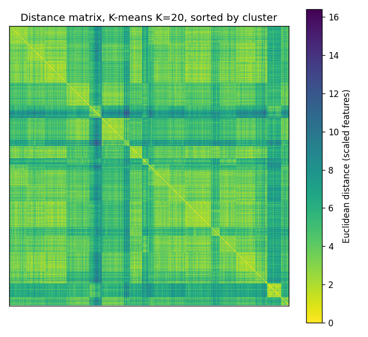

# Clustering accounts without labels (Person A)

## Headline: do mules cluster together without labels?

48,515 active accounts, 455 of them mules (base rate 0.94%). Clustering never sees a label; true roles are joined afterwards. Lift = a cluster's mule share / the base rate.

At K = 20, K-means puts 167 mules in one cluster of 1,098 accounts (15.2% mules, lift 16.2). 77% of all mules sit in clusters with lift >= 5 (bisecting K-means: 59%). At K = 2, the small cluster holds 65% of mules at lift 6.8.

**No cluster is mostly mules**: the best holds 15.2% mules, so it is a strong pointer, not a mule list. The handoff called this a hope, not a guarantee; this is what the data shows.

K-means, K = 20, clusters by lift:

| cluster | size | mules | mule_share | lift |
|---|---|---|---|---|
| 5 | 1098 | 167 | 0.1521 | 16.22 |
| 4 | 1000 | 75 | 0.075 | 7.997 |
| 9 | 1143 | 65 | 0.05687 | 6.064 |
| 10 | 882 | 44 | 0.04989 | 5.319 |
| 14 | 1554 | 22 | 0.01416 | 1.51 |
| 15 | 2764 | 18 | 0.006512 | 0.6944 |
| 11 | 2682 | 12 | 0.004474 | 0.4771 |
| 19 | 1434 | 6 | 0.004184 | 0.4461 |

## 1. Features and scaling

Flow and network features plus night share and burstiness (12 columns): `total_inflow`, `total_outflow`, `pass_through_ratio`, `avg_dwell_hours`, `in_degree`, `out_degree`, `new_counterparty_share`, `fan_in_max_24h`, `fan_out_max_24h`, `neighbor_suspicious_share`, `night_txn_share`, `burstiness`. Heavy-tailed columns get `log1p` first (`total_inflow`, `total_outflow`, `avg_dwell_hours`, `in_degree`, `out_degree`, `fan_in_max_24h`, `fan_out_max_24h`), then every column is standardised so no single feature dominates the distance. Only active accounts (money in and out of the window) are clustered; the rest have no flow to describe. `prepare()` refuses `label`, `role` and `is_fraud`.

## 2. K-means and choosing K

The largest SSE drop is from K = 2 to 3, after which it flattens gradually rather than at one sharp elbow. Silhouette (on a 5,000-account sample) is highest at K = 2, so that is the reported K. Because a 2-way split cannot show the finer mule groups, the report also uses K = 20, the top of the sweep. K is never chosen using labels; `mule_capture_lift5` is shown only for reading.

| k | sse | silhouette | mule_capture_lift5 |
|---|---|---|---|
| 2 | 472949 | 0.3831 | 0.6462 |
| 3 | 392556 | 0.2481 | 0.6176 |
| 4 | 360082 | 0.1788 | 0.567 |
| 5 | 334554 | 0.1821 | 0 |
| 6 | 312068 | 0.1885 | 0.5912 |
| 7 | 291230 | 0.1927 | 0.5692 |
| 8 | 274658 | 0.1714 | 0.5099 |
| 9 | 261254 | 0.1651 | 0.5055 |
| 10 | 250349 | 0.1589 | 0.6747 |
| 11 | 241732 | 0.1548 | 0.6703 |
| 12 | 236237 | 0.1526 | 0.6418 |
| 13 | 230476 | 0.1456 | 0.6396 |
| 14 | 226314 | 0.138 | 0.6374 |
| 15 | 222212 | 0.1381 | 0.6198 |
| 16 | 218396 | 0.1284 | 0.6813 |
| 17 | 215197 | 0.1263 | 0.6813 |
| 18 | 211487 | 0.1257 | 0.6769 |
| 19 | 208629 | 0.1242 | 0.6791 |
| 20 | 206146 | 0.1272 | 0.7714 |

## 3. Bisecting K-means vs K-means

At K = 2 the two are identical: bisecting K-means starts with one 2-way K-means split. At K = 20, K-means has lower SSE and captures more mules in high-lift clusters. Bisecting K-means never revisits a split once made, which usually costs it some SSE; it is faster and its clusters form a hierarchy.

| method | k | sse | silhouette | top_lift | mule_capture_lift5 |
|---|---|---|---|---|---|
| kmeans | 2 | 472949 | 0.3831 | 6.797 | 0.6462 |
| bisecting_kmeans | 2 | 472949 | 0.3831 | 6.797 | 0.6462 |
| kmeans | 20 | 206146 | 0.1272 | 16.22 | 0.7714 |
| bisecting_kmeans | 20 | 223703 | 0.09709 | 14.67 | 0.5934 |

Bisecting K-means, K = 20, clusters by lift:

| cluster | size | mules | mule_share | lift |
|---|---|---|---|---|
| 19 | 1963 | 270 | 0.1375 | 14.67 |
| 3 | 854 | 38 | 0.0445 | 4.745 |
| 11 | 1653 | 35 | 0.02117 | 2.258 |
| 18 | 2649 | 24 | 0.00906 | 0.966 |
| 12 | 1056 | 9 | 0.008523 | 0.9087 |

## 4. Proximity matrix

Pairwise distances of a 2,000-account sample stratified by cluster, rows and columns sorted by cluster. Light blocks on the diagonal are tight clusters; dark bands are small, far-out clusters.

## 5. Cohesion and separation

SSE is within-cluster scatter (cohesion), SSB is between-cluster scatter (separation); SSE + SSB is the fixed total, so lowering one raises the other.

| method | k | sse | ssb | silhouette |
|---|---|---|---|---|
| kmeans | 2 | 472949 | 109231 | 0.3831 |
| bisecting_kmeans | 2 | 472949 | 109231 | 0.3831 |
| kmeans | 20 | 206146 | 376034 | 0.1272 |
| bisecting_kmeans | 20 | 223703 | 358477 | 0.09709 |

## 6. Supervised validity against true roles

About 99% of accounts are not mules, so purity is high for any clustering and ARI stays near zero even when mules are concentrated. That is why lift is the headline.

| method | k | purity_role | entropy_role | ari_role | ari_mule |
|---|---|---|---|---|---|
| kmeans | 2 | 0.7263 | 1.014 | 0.1269 | 0.09033 |
| bisecting_kmeans | 2 | 0.7263 | 1.014 | 0.1269 | 0.09033 |
| kmeans | 20 | 0.9463 | 0.3015 | 0.07703 | 0.001318 |
| bisecting_kmeans | 20 | 0.9223 | 0.3815 | 0.06569 | 0.0008146 |

## 7. Significance: shuffled baseline

Each feature column is permuted independently (same distributions, no joint structure) and clustered again, 20 times per K. Real silhouette is at least 6.7 standard deviations above the shuffled mean at every K reported, and real SSE is lower, so the structure is not chance.

| k | real_silhouette | real_sse | shuffled_silhouette_mean | shuffled_silhouette_sd | shuffled_sse_mean | silhouette_gap_in_sd |
|---|---|---|---|---|---|---|
| 2 | 0.3831 | 472949 | 0.1141 | 0.04021 | 547546 | 6.688 |
| 20 | 0.1272 | 206146 | 0.06427 | 0.002858 | 328783 | 22.02 |

## 8. Cluster profiles (K = 20, sorted by mule share)

Mean feature values and role mix per cluster. The top cluster (5) forwards most of what it receives (pass-through 0.74 vs 0.10 overall), quickly (dwell 32 h vs 174 h) and from many senders (24 h fan-in 8.0 vs 2.3). 85% of its members are not mules: the money collectors, shop phones and new accounts with large first receipts were added as hard cases (plan rev 4) precisely so that this shape is not unique to mules. The other mule-rich clusters (4, 9, 10) look different, e.g. pass-through 0.29, 0.73, 0.06: mules are not one shape, which is why one cluster cannot hold them all.

| cluster | size | mule_share | pass_through_ratio | avg_dwell_hours | fan_in_max_24h | fan_out_max_24h | in_degree | night_txn_share | role_merchant | role_normal |
|---|---|---|---|---|---|---|---|---|---|---|
| 5 | 1098 | 0.1521 | 0.7433 | 32.36 | 8.014 | 3.684 | 25.04 | 0.1212 | 0.01002 | 0.8005 |
| 4 | 1000 | 0.075 | 0.2853 | 98.58 | 8.164 | 3.585 | 31.22 | 0.1085 | 0.083 | 0.82 |
| 9 | 1143 | 0.05687 | 0.7338 | 31.55 | 1.284 | 2.619 | 3.057 | 0.05205 | 0.1741 | 0.7375 |
| 10 | 882 | 0.04989 | 0.05865 | 189.7 | 1.33 | 2.091 | 3.052 | 0.07191 | 0.02154 | 0.8719 |
| 14 | 1554 | 0.01416 | 0.05285 | 193.8 | 1.752 | 2.725 | 3.826 | 0.3171 | 0.003217 | 0.9595 |
| 15 | 2764 | 0.006512 | 0.1913 | 73.64 | 1.3 | 3.002 | 2.975 | 0.04901 | 0.0007236 | 0.9294 |
| 11 | 2682 | 0.004474 | 0.08398 | 110.8 | 1.248 | 2.943 | 2.855 | 0.04565 | 0.004101 | 0.9053 |
| 19 | 1434 | 0.004184 | 0.1005 | 133.6 | 2.381 | 1.506 | 10.93 | 0.05126 | 0.9707 | 0.02371 |
| 7 | 1065 | 0.003756 | 0.02117 | 238.3 | 1.833 | 1.131 | 7.503 | 0.05824 | 0.5944 | 0.4019 |
| 8 | 2176 | 0.003217 | 0.02195 | 253.5 | 1.483 | 2.358 | 3.701 | 0.1682 | 0.003217 | 0.977 |
| 0 | 3187 | 0.003138 | 0.01822 | 264.6 | 1.572 | 2.458 | 4.061 | 0.06078 | 0 | 0.9602 |
| 2 | 3842 | 0.002603 | 0.0312 | 209.3 | 1.693 | 2.85 | 4.137 | 0.04583 | 0 | 0.9615 |
| 6 | 3784 | 0.001586 | 0.06849 | 148.8 | 2.222 | 1.278 | 10.13 | 0.05022 | 0.9799 | 0.0185 |
| 13 | 4497 | 0.0008895 | 0.02991 | 217.9 | 1.386 | 3.425 | 3.44 | 0.04303 | 0.0008895 | 0.9726 |
| 16 | 3354 | 0.0005963 | 0.02444 | 211.4 | 1.219 | 2.094 | 3.055 | 0.03445 | 0.002385 | 0.977 |
| 17 | 2054 | 0.0004869 | 0.02479 | 230.7 | 1.437 | 1.921 | 3.301 | 0.0514 | 0 | 0.9883 |
| 18 | 2407 | 0.0004155 | 0.05257 | 183.6 | 10.09 | 2.663 | 120.3 | 0.05422 | 0.9975 | 0.002077 |
| 3 | 3973 | 0.0002517 | 0.1902 | 91.27 | 2.375 | 2.1 | 10.66 | 0.05148 | 0.9892 | 0.01057 |
| 1 | 2920 | 0 | 0.01677 | 299 | 1.396 | 2.192 | 3.248 | 0.03165 | 0.006164 | 0.9863 |
| 12 | 2699 | 0 | 0.04498 | 96.97 | 1.033 | 2.515 | 1.651 | 0.03735 | 0.01371 | 0.9655 |

## K-means as an optimisation problem

K-means minimises SSE, the sum of squared distances from each point to its cluster's centroid. Lloyd's algorithm alternates two steps that can only lower SSE: assign each point to its nearest centroid, then move each centroid to the mean of its points. It always converges, but to a local minimum that depends on the start, so each fit keeps the best of 10 k-means++ starts.

## Strengths, weaknesses and cluster types

- **Strengths:** simple, fast (linear in the number of accounts), and easy to explain; centroids are readable profiles.
- **Weaknesses:** K must be chosen; it is sensitive to scaling and outliers (hence log1p and standardising); and it only finds local minima.
- **Cluster types:** K-means favours round clusters of similar size and spread. Mules are a small, varied group among 48,060 other accounts, so K-means splits them across clusters and merges them with similar-looking hard cases. Density-based methods would handle that shape better; they are outside this unit.
