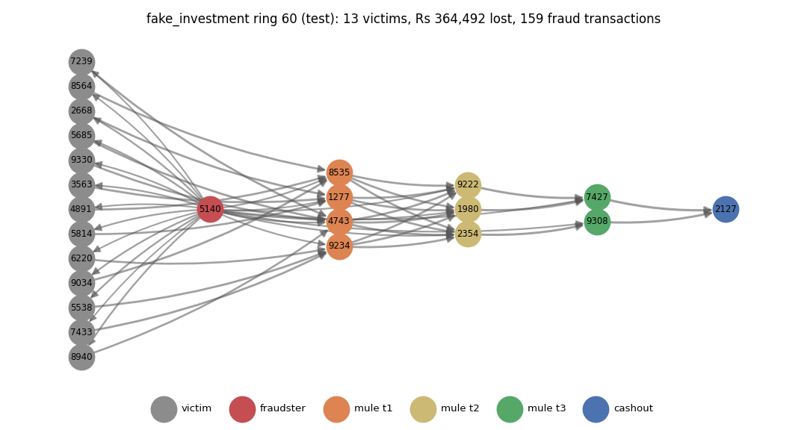
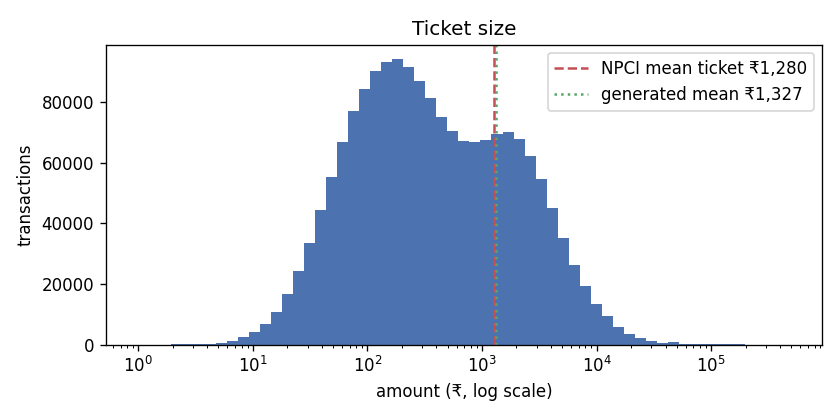
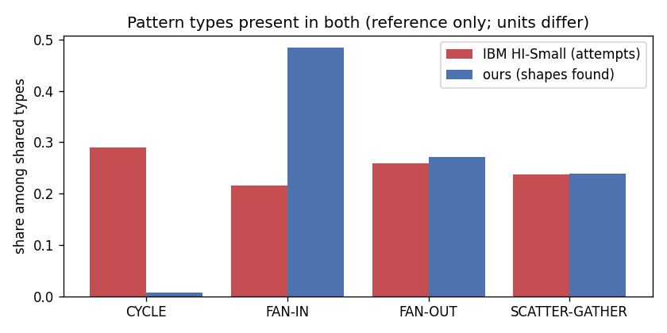

# Chapter 1. Data and validation

> Real transaction data is legally unavailable; we built a simulator calibrated to NPCI/RBI statistics and validated against the IBM AML benchmark.

This chapter describes that simulator, where each of its numbers comes from, how we checked that its output looks like UPI, and what simulated data cannot tell us. The full tables and figures are in [`reports/a_01_simulator.md`](../a_01_simulator.md), which `python -m simulator.validate` regenerates.

## 1.1 Why a simulator

Bank transaction records are confidential customer data, so no Indian UPI dataset with account-to-account links and fraud labels is public. The public alternatives fail for our purpose:

- **Kaggle "UPI" datasets** are flat tables with no account network. In many of them, the fraud flag is assigned almost at random, so a model can learn nothing real from it.
- **PaySim's fraud** follows one simple rule (models reach about 100%), and it has almost no multi-hop chains.
- **IBM AML** has the network structure we need, but it is not Indian (dollars and other currencies, US-style banking). We use it only to check structure.

A mule network is a *graph* problem: money moves from a victim through tiers of mule accounts to a cash-out account within hours. So we built a simulator that produces both the transactions and the network, with known ground truth for every account.

## 1.2 What the simulator produces

| Item | Value |
|---|---|
| Window | 2025-08-13 to 2025-11-10 (90 days, covering Dussehra and Diwali) |
| Accounts | 50,377 (36,086 ordinary personal accounts, 12,500 merchants, 1,186 victims, 605 fraud accounts) |
| Transactions | 1,803,905 |
| Fraud rings | 75, 15 per scam scenario |
| Fraud accounts | 605 (1.20%): 75 fraudsters, 170 tier-1, 214 tier-2 and 71 tier-3 mules, 75 cash-out accounts |
| Fraud transactions | 7,347 (0.41%), under the handoff's 1% ceiling |

Output follows the shared contract (`CONTRACTS.md`): `accounts.csv`, `transactions.csv` and the per-account `features.parquet`. Account and device ids are assigned in random order so an id never hints at a role. The whole dataset is reproducible: the same seed and pinned package versions give byte-identical files, which `CHECKSUMS.txt` verifies.

**Normal behaviour.** Five account types (salaried, student, gig worker, small and large merchant) make:

- merchant payments (P2M)
- family transfers
- bills and rent (spread over days 1–15)
- supplier payments
- gig payouts
- the small share of salaries paid over UPI

Volume follows an hour-of-day curve, weekends and month-start, and festival effects measured from NPCI's daily figures: a dip around Dussehra, +4.7% for Dhanteras–Diwali and −11.3% just after.

**Five scam scenarios** (handoff §4.3), each with its own amounts and timing:

| Scenario | Rings | Fraud accounts | Victims | Fraud transactions | Mean loss per victim |
|---|---|---|---|---|---|
| Digital arrest | 15 | 118 | 15 | 1,200 | Rs 137,675 |
| Fake investment | 15 | 125 | 176 | 1,783 | Rs 22,713 |
| Fake KYC | 15 | 122 | 15 | 289 | Rs 30,086 |
| Job / task scam | 15 | 125 | 583 | 1,275 | Rs 2,679 |
| Loan app | 15 | 115 | 397 | 2,800 | Rs 9,629 |

The scenarios differ on purpose: a digital-arrest victim pays several large instalments, a job-task victim a few small "fees". Across all victims the mean loss is Rs 10,032. The only official figure, the Lok Sabha FY2024-25 average (₹981 crore over 12.64 lakh incidents ≈ Rs 7,761), is per *reported incident*, and one victim can report several. So it is a sanity check, not a target to hit exactly.

**Mule networks.** Each ring has one fraudster, mule tiers and one cash-out account. Most rings have 2–4 tier-1 mules, 1–3 tier-2 and 0–2 tier-3. In fake-KYC and digital-arrest rings the victim pays a single account, so there is one tier-1 mule that fans out to 2–6 tier-2 mules. Money is laundered with the patterns the handoff names:

- fan-out
- fan-in
- chains
- scatter-gather
- cycles (in some rings)

Each hop waits a lognormal delay with a median of 2 hours (σ = 1.5, capped at 48 h), so about 95% of hops happen within 24 hours.

## 1.3 Noise and hard cases

A simulator in which fraud looks nothing like normal behaviour produces a meaningless 100% score. The handoff requires noise (§4.5), and our first full dataset proved why: the first random forest scored a test PR-AUC of 0.98, catching every mule. The cause was not a leak. Mules differed from normal accounts on every axis at once: new accounts, shared phones, fast forwarding and night activity. So we added noise to *both* sides:

**Mules that look normal**
- 50% of mules are **sleepers**: existing accounts with at least 21 days of ordinary history, sending from their own phones (see the timeline in `a_01_simulator.md`).
- 30% are **patient**: they wait 24–47 hours before forwarding, still inside Person B's 48-hour hop rule.
- Each ring spreads its members over 2–4 phones instead of one.
- 22 of the 75 rings **split payments** to 90–99.9% of Rs 10k / 25k / 50k to stay under thresholds.

**Normal accounts that look like mules (hard negatives)**
- 5% of personal accounts are **money collectors** (a chit fund, a society treasurer, a group trip): they collect from 3–8 people and pass 85–100% on within hours.
- 5% of small merchants form a **shop-phone group**: the shop and 2–5 staff paying from one phone.
- 40% of accounts opened during the window receive a **large first payment** (Rs 10k–60k) within 20 days.
- 30% of gig workers work **night shifts**.
- 1% of users make one **genuine outlier** payment (a wedding, a hospital bill, a phone). The example in the report paid Rs 55,025, 313 times their median.

**Label noise.** In `accounts.csv`, 9 fraud accounts are labelled 0 and 9 normal accounts are labelled 1 (1.5% of positives, with prevalence kept the same). `role` and `transactions.csv` stay clean, so validity checks use the truth.

After these changes the best model scores 0.915 rather than 0.98, and no single feature reaches 0.21 on its own (Chapter 2).

## 1.4 Calibration sources

Every number lives in `simulator/config.yaml` as `{value, source, status}`, so each assumption can be traced. Of the 77 values, **12 are sourced**:

| Value | Source |
|---|---|
| Mean ticket Rs 1,280 | NPCI UPI daily statistics, 13 Aug – 10 Nov 2025 (total value ÷ volume) |
| Weekend volume factor 1.0; Sunday value factor 0.83 | NPCI daily statistics |
| Month-start (days 1–5) value +17% | NPCI daily statistics |
| Festival effects (Dussehra, Dhanteras–Diwali, post-Diwali) | NPCI daily statistics, each against its own baseline |
| 90-day window; train/val/test days 1–60 / 61–75 / 76–90 | Handoff §4.1 and §6 |
| Thresholds Rs 10k / 25k / 50k | Handoff §4.3 |
| Label noise 1.5% | Handoff §4.5 (1–2%) |
| Average loss Rs 7,761 (check only) | Lok Sabha Unstarred Question 2481, 15 Dec 2025 |

The other **65 are `assumed`**. Some are design choices from our plan; others have no public source. All of them are listed in the appendix at the end of this chapter, so nothing is passed off as measured. The P2M share (62%) comes from a secondary news source and is marked `assumed` for that reason.

## 1.5 Validation results

Every check reports the target, the generated value and the gap (handoff §5.3, plan D20). Shares must be within ±3 percentage points of the target and the mean ticket within ±15%.

| Check | Target | Generated | Result |
|---|---|---|---|
| Mean ticket | Rs 1,280 | Rs 1,352 | PASS |
| P2M share | 0.62 | 0.623 | PASS |
| P2M share of payments ≤ Rs 500 | 0.86 | 0.884 | PASS |
| Hour-of-day curve (total variation distance) | ≤ 0.05 | 0.010 | PASS |
| Night share (23:00–04:59) | 0.057 | 0.065 | PASS |
| Weekend volume factor | 1.00 | 0.987 | PASS |
| Sunday value factor | 0.83 | 0.810 | PASS |
| Month-start value factor | 1.17 | 1.195 | PASS |
| Dussehra / Dhanteras–Diwali / post-Diwali | +0.3% / +4.7% / −11.3% | +0.5% / +4.4% / −9.2% | PASS |
| Fraud share of transactions | < 1% | 0.41% | PASS |
| Fraud share of accounts | 0.8–1.8% | 1.20% | PASS |
| Every scenario present | > 0 each | 289–2,800 | PASS |
| Models not near 100% (check 6) | < 0.98 | 0.915 | PASS (Chapter 2) |

**IBM AML structure check.** We parsed IBM's `HI-Small_Patterns.txt`, which has 370 laundering attempts of 8 types. We implement four of those types (fan-out, fan-in, scatter-gather and cycle), and all four appear in our fraud graph, so the check passes. The mix is reported but not judged, because our own config sets it.

The mixes do differ:
- Our fraud graph is dominated by chains (3,531 detected, 87%), which IBM does not label.
- Cycles are rare in ours (4) but 15% of IBM's.
- Bipartite, gather-scatter, stack and random are not implemented.

## 1.6 Limitations of simulated data

- **The model learns our assumptions.** Fraud looks the way we wrote it. A high score shows the features capture the patterns we built, not that they would catch real mules. The hard cases make the task harder, but they are also our invention.
- **65 of 77 values are assumed.** NPCI publishes totals, not per-user behaviour, so the occupation mix, transaction rates, hour curve and every fraud parameter are reasoned guesses.
- **Calibration is to averages.** Matching the mean ticket, channel mix and daily shape does not mean the joint behaviour of any single account is realistic.
- **The pattern mix is not IBM's**, and we did not implement four of its pattern types.
- **One seed, one world.** All results come from a single generated dataset; a different seed would move every number a little.
- **Scale.** 50,000 accounts is about 0.01% of UPI's user base. Real mule rings also share infrastructure across rings, which ours do not.
- **Labels are perfect underneath.** Real labels arrive late, are incomplete and are biased towards cases that someone reported.

The honest claim is therefore narrow: the methods work on data with UPI's measured aggregate shape and realistic laundering structure, and every assumption behind that data is listed.

## Appendix 1A. Every `assumed` config value

| Key | Value | Why / source |
|---|---|---|
| `seed` | 42 | assumed: fixed seed for reproducibility |
| `window.start` | 2025-08-13 | plan D5 (our choice): 90-day window covering Dussehra (day 51) and Diwali (day 69), with NPCI data for the same months |
| `splits.shares` | {"train": 0.5, "val": 0.25, "test": 0.25} | plan D7/D8: rings and normal accounts split 50/25/25 |
| `splits.lookback_days` | 30 | plan D8: features use a 30-day window ending on the split's last day |
| `splits.new_counterparty_history_days` | 30 | plan rev 2: fixed 30-day history for new_counterparty_share |
| `splits.ring_tail_days` | 6 | plan D8 / rev 4: rings start at least 6 days before their split ends, leaving room for patient hops |
| `population.n_accounts` | 50000 | plan D6, inside handoff §4.1 range of 20k-50k |
| `population.small_n_accounts` | 5000 | plan D6: --small config for development and tests |
| `population.type_mix` | {"salaried": 0.42, "student": 0.18, "gig_worker": 0.15, "... | assumed: no public split of UPI users by occupation; merchants about a quarter of accounts |
| `population.new_account_share` | 0.08 | plan D24: normal accounts opened during the window, so being new is not unique to mules |
| `population.shared_device_household_share` | 0.04 | plan D24: households sharing one phone, so device sharing is not unique to mules |
| `population.family_size` | [1, 4] | assumed: 1-4 family accounts per user for P2P transfers |
| `bank_mix` | {"SBI": 0.3, "HDFC": 0.18, "ICICI": 0.15, "Axis": 0.1, "P... | assumed: bank list and market-share weighting idea from the Kaggle synthetic 'UPI Transactions 2024' dataset (secondary, design idea only) |
| `state_mix` | {"Maharashtra": 0.16, "Uttar Pradesh": 0.14, "Karnataka":... | assumed: state list from the Kaggle synthetic UPI dataset (secondary); weights roughly by population and digital adoption |
| `ticket_size.p2m` | {"median": 120, "sigma": 1.0} | assumed; tuned with bills so that about 86% of all P2M payments are <= Rs 500 (secondary: Outlook Money, Feb 2025) |
| `ticket_size.p2p_family` | {"median": 1600, "sigma": 0.9} | assumed |
| `ticket_size.bills` | {"median": 350, "sigma": 0.7} | assumed: bills and mobile recharges |
| `ticket_size.rent` | {"median": 8000, "sigma": 0.5} | assumed |
| `ticket_size.salary` | {"median": 15000, "sigma": 0.5} | assumed: wages paid over UPI come mostly from small employers (shops, domestic work); corporate salaries use NEFT |
| `ticket_size.gig_payout` | {"median": 2000, "sigma": 0.6} | assumed: weekly gig-platform payouts |
| `ticket_size.supplier` | {"median": 4000, "sigma": 0.8} | assumed: merchant payments to suppliers |
| `channel_mix` | {"P2P": 0.38, "P2M": 0.62} | secondary, not NPCI: Outlook Money (FY2024-25 to Jan 2025) reports 62.35% P2M by volume; Meetanshi (Feb 2026, citing NPCI) 62.4%. NPCI's ecosystem statistics page was unavailable on 2026-10-27 (API 503/403) |
| `hour_of_day` | [0.8, 0.4, 0.25, 0.2, 0.2, 0.4, 1.2, 2.8, 4.5, 5.5, 6.3, ... | assumed: NPCI publishes no hour-of-day data; daytime plateau with an evening peak and a night trough |
| `behaviours.salaried` | {"p2m_per_day": 0.3, "p2p_per_day": 0.1, "bills_per_month... | assumed; rates tuned so the default config gives about 1.5M transactions (plan D6) with the NPCI mean ticket |
| `behaviours.student` | {"p2m_per_day": 0.22, "p2p_per_day": 0.08, "bills_per_mon... | assumed |
| `behaviours.gig_worker` | {"p2m_per_day": 0.26, "p2p_per_day": 0.12, "bills_per_mon... | assumed; weekly platform payouts |
| `behaviours.small_merchant` | {"p2m_per_day": 0.06, "p2p_per_day": 0.08, "supplier_per_... | assumed: merchants mostly receive |
| `behaviours.large_merchant` | {"p2m_per_day": 0.03, "p2p_per_day": 0.02, "supplier_per_... | assumed; large merchants also pay salaries and gig payouts (plan D13) |
| `behaviours.salary_via_upi_share` | 0.05 | assumed: most salaries arrive by NEFT/IMPS, not UPI; only these salary credits appear in UPI data |
| `behaviours.merchant_size_weight` | {"small_merchant": 1.0, "large_merchant": 8.0} | assumed: large merchants receive about 8x the P2M payments of small ones |
| `behaviours.phone_change_share` | 0.02 | assumed: accounts that change phone once mid-window |
| `hard_cases.money_collector_share` | 0.05 | assumed: people who collect money from several others and pass it on the same day (group funds, family pooling, informal agents) |
| `hard_cases.collections_per_month` | 4 | assumed |
| `hard_cases.collection_size` | [3, 8] | assumed: payers per collection |
| `hard_cases.collection_amount` | {"median": 1500, "sigma": 0.8} | assumed |
| `hard_cases.forward_share` | [0.85, 1.0] | assumed: share of the collected money passed on |
| `hard_cases.forward_delay` | {"median_h": 3.0, "sigma": 0.8} | assumed: hours before passing the money on |
| `hard_cases.shop_phone_group_share` | 0.05 | assumed: small shops where the owner and staff pay from one phone |
| `hard_cases.shop_phone_group_size` | [3, 6] | assumed: accounts per shared shop phone (the shop plus 2-5 staff) |
| `hard_cases.new_account_large_receipt_share` | 0.4 | assumed: new accounts whose first large receipt is a first salary, fees or a family transfer |
| `hard_cases.new_account_large_receipt_days` | [1, 20] | assumed: days after opening |
| `hard_cases.new_account_large_receipt_amount` | [10000, 60000] | assumed |
| `hard_cases.night_worker_share` | 0.3 | assumed: gig workers on night shifts (delivery, ride-hailing) |
| `hard_cases.night_shift_hours` | 12 | assumed: their hour-of-day curve is shifted by 12 hours |
| `outliers.account_rate` | 0.01 | assumed: genuine one-off spikes (wedding, hospital bill, phone purchase) |
| `outliers.multiplier` | [10, 40] | assumed: outlier amount = 10-40x the account's median |
| `fraud.rings_per_scenario` | 15 | plan D7 (review rev 2) |
| `fraud.small_rings_per_scenario` | 4 | assumed: --small development config (5,000 accounts) keeps the fraud share moderate |
| `fraud.ring_size` | {"mule_t1": [2, 4], "mule_t2": [1, 3], "mule_t3": [0, 2],... | plan D7: about 8 accounts per ring with the fraudster |
| `fraud.max_ring_days` | 8 | plan D8: rings fit inside the 15-day val/test periods |
| `fraud.sleeper_share` | 0.5 | plan D14 / handoff §4.5 sleeper mules; raised to 0.50 in plan rev 4 (many mules are recruited existing accounts) |
| `fraud.sleeper_min_history_days` | 21 | plan D14 |
| `fraud.fresh_mule_age_days` | [3, 20] | plan D14: fresh mules opened 3-20 days before the ring |
| `fraud.threshold_split_share` | 0.3 | plan D14 |
| `fraud.threshold_band` | [0.9, 0.999] | plan D12/D14: same band as the below_threshold feature |
| `fraud.hop_delay` | {"median_h": 2.0, "sigma": 1.5, "cap_h": 48} | plan D14 (rev 2): about 95% of hops within 24 h; Person B's 48 h hop rule |
| `fraud.mule_commission` | [0.92, 0.99] | plan Task 5: each mule forwards 92-99% of what it received |
| `fraud.mule_devices_per_ring` | [2, 4] | plan rev 4: fresh mules and the fraudster spread over 2-4 ring phones (fewer accounts per phone); sleepers use their own |
| `fraud.patient_mule_share` | 0.3 | plan rev 4: about 30% of mules wait before forwarding (hard case for pass-through) |
| `fraud.patient_delay_h` | [24, 47] | plan rev 4: patient mules wait 1-2 days, kept inside Person B's 48 h hop window |
| `scenarios.fake_kyc` | {"victims": [1, 1], "payments_per_victim": [1, 1], "amoun... | handoff §4.3 shape; amounts assumed, scaled (plan rev 4) so the average loss per victim is near the Lok Sabha Rs 7,761 per incident |
| `scenarios.digital_arrest` | {"victims": [1, 1], "payments_per_victim": [3, 8], "amoun... | handoff §4.3 shape; amounts assumed, scaled (plan rev 4) so the average loss per victim is near the Lok Sabha Rs 7,761 per incident |
| `scenarios.job_task` | {"victims": [15, 60], "payments_per_victim": [1, 1], "amo... | handoff §4.3 shape; amounts assumed, scaled (plan rev 4) so the average loss per victim is near the Lok Sabha Rs 7,761 per incident |
| `scenarios.loan_app` | {"victims": [10, 40], "payments_per_victim": [2, 5], "amo... | handoff §4.3 shape; amounts assumed, scaled (plan rev 4) so the average loss per victim is near the Lok Sabha Rs 7,761 per incident |
| `scenarios.fake_investment` | {"victims": [5, 20], "returns_per_victim": [1, 3], "retur... | handoff §4.3 shape; amounts assumed, scaled (plan rev 4) so the average loss per victim is near the Lok Sabha Rs 7,761 per incident |
