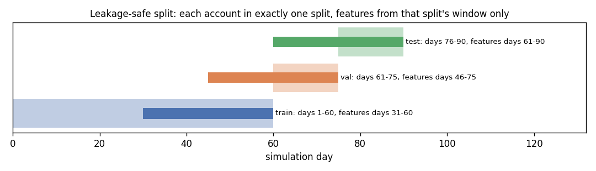
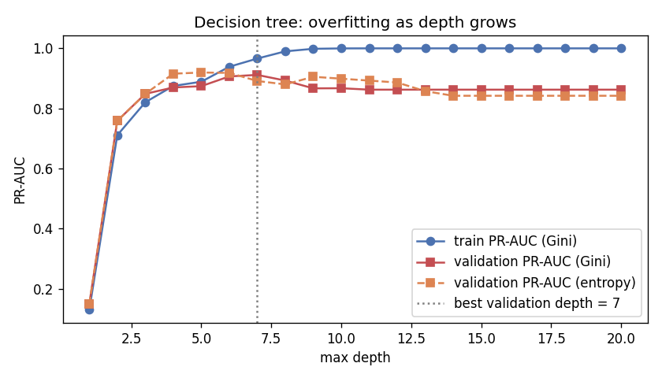
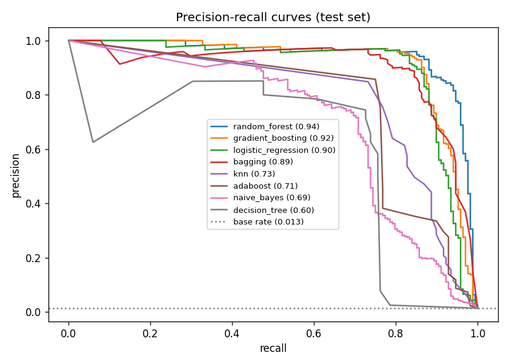

# Chapter 2. Supervised models

This chapter trains eight classifiers to flag mule-network accounts from their transaction behaviour, and compares them on one leaderboard. Every model uses the same 20 features and the same leakage-safe split. Full tables and figures are in [`reports/a_05_classifiers.md`](../a_05_classifiers.md), which `python -m mulehunt.models --all` regenerates.

## 2.1 The task, and why accuracy is not the metric

Each account gets one label: fraud (fraudster, mule or cash-out) or not. Only 1.34% of test accounts are fraud, so:

| Model | Accuracy | Precision | Recall | F1 | PR-AUC |
|---|---|---|---|---|---|
| Always says "not fraud" | 98.66% | 0 | 0 | 0 | 0.013 |
| Random forest (best) | 99.63% | 0.962 | 0.753 | 0.845 | 0.915 |

A model that catches nobody is 98.7% accurate, so accuracy hides everything that matters. We report:
- **precision:** of the flagged accounts, the share that really are fraud
- **recall:** of the fraud accounts, the share flagged
- **F1**
- **PR-AUC:** the area under the precision–recall curve. It does not depend on a threshold, and a random model scores the base rate.
- **recall at a 1% false-alarm rate**

**Why precision matters (ethics).** Flagging an account can mean freezing it, and wrongly freezing a genuine user's account cuts them off from salary, rent and family money. At the chosen threshold, the random forest flags 133 of the 12,660 test accounts:
- **128** are fraud
- **5** are genuine users, out of 12,490
- **42** fraud accounts are missed

Lowering the threshold to allow a 1% false-alarm rate would catch 156 fraud accounts but wrongly flag 125 genuine users. That trade-off is a policy decision, not a modelling one. It is why the dashboard shows a score and its reasons, and why a flag should prompt review rather than an automatic freeze.

## 2.2 Features

Each account is described by its transactions inside a 30-day window. No feature reads `role`, `is_fraud` or `scenario`. There are 20 features in four families (handoff §6, plan D12):

| Family | Features |
|---|---|
| Flow (4) | total inflow, total outflow, **pass-through ratio**, **average dwell hours** |
| Network (6) | in-degree, out-degree, new-counterparty share, max fan-in and fan-out within 24 h, share of counterparties that are themselves fast forwarders |
| Behavioural (7) | transaction count, night share (23:00–04:59), round-amount share, just-below-threshold share, burstiness, has a large receipt, account age at first large receipt |
| Device / location (3) | devices used, other accounts on the same devices, counterparty state mismatch |

**Pass-through and dwell are computed by first-in-first-out matching.** Each rupee sent out is matched to the earliest unmatched rupee received, so no rupee is counted twice:
- **Pass-through** = rupees forwarded within 24 hours of arriving ÷ rupees received.
- **Dwell** = the amount-weighted time money stays before leaving.

Without matching, 30 small inflows could all "share" one outflow and report a pass-through of 1.0.

**"Neighbours flagged" is label-free.** The handoff suggested a feature from neighbours' fraud labels. That would leak labels into scoring, so `neighbor_suspicious_share` instead uses neighbours' own pass-through (≥ 0.8), which needs no label.

## 2.3 A leakage-safe split

The handoff asks for a time split (train days 1–60, validation 61–75, test 76–90) and also says no account may appear in both train and test. For account-level features, these two rules conflict. We reconcile them as follows:
- **Whole groups in one split.** Each fraud ring, with all its members, belongs to exactly one split, and so does each normal account (50/25/25).
- **One window per split.** Features come from the 30 days ending on that split's last day, so test features use days 61–90 only.

| Split | Days | Feature window | Accounts | Fraud labels | Rings |
|---|---|---|---|---|---|
| Train | 1–60 | 31–60 | 25,098 | 278 | 35 |
| Validation | 61–75 | 46–75 | 12,619 | 157 | 20 |
| Test | 76–90 | 61–90 | 12,660 | 170 | 20 |

Other leakage controls:
- **SMOTE** runs inside the training pipeline only.
- **Hyperparameters and decision thresholds** (the best F1) are chosen on validation, and test is used once.
- **Confidence intervals** resample whole rings, because ring-mates share devices and timing. Resampling them one at a time would make the intervals look too tight.

**The sanity gate (handoff §5.3, check 6).** We print the PR-AUC of each feature used alone before trusting any model. If any feature exceeds 0.9, or any model exceeds 0.98, we stop and look for a shortcut. The first dataset tripped the gate (Chapter 1.3). On the final data the best single feature reaches only 0.211 (`neighbor_suspicious_share`), and the best model 0.915: **PASS**.

## 2.4 Decision tree: complexity, impurity and pruning

We grew trees of depth 1–20 and plotted training against validation PR-AUC:
- **Overfitting:** training PR-AUC keeps rising with depth, while validation peaks and then falls. Deeper trees memorise the training accounts.
- **Gini vs entropy:** the best validation PR-AUC is 0.514 at depth 8 with Gini and 0.656 at depth 9 with entropy, so entropy splits better here.
- **Pruning:** cost-complexity pruning reaches its best validation PR-AUC, 0.539, with 101 leaves (α = 1.19 × 10⁻⁴). The pruned tree is the "mule rulebook" in the report: each line is an attribute test condition, such as `neighbor_suspicious_share <= 0.079`.

The leaderboard tree searched depth only, with the default Gini criterion, and scores 0.526 on test. Since the study shows entropy doing better on validation, adding the criterion to the leaderboard's search is a known, small improvement we have not made.

## 2.5 Models and class imbalance

| Model | Imbalance handling |
|---|---|
| Decision tree, random forest, bagging, gradient boosting, AdaBoost, logistic regression | Balanced class weights |
| KNN (scaled features) | SMOTE, on training rows only |
| Naive Bayes | Class priors from the data |

To compare the techniques directly, we fitted logistic regression three ways:

| Logistic regression | Validation PR-AUC | Test PR-AUC |
|---|---|---|
| No handling | 0.778 | 0.842 |
| Balanced class weights | 0.756 | 0.832 |
| SMOTE (training only) | 0.748 | 0.819 |

No handling is best. PR-AUC measures ranking, and re-weighting mostly shifts the scores up for the rare class. Since the threshold is tuned on validation anyway, imbalance handling matters less here than its reputation suggests.

## 2.6 Leaderboard (test split)

| Model | PR-AUC | 95% CI (ring bootstrap) | Precision | Recall | F1 | Recall at 1% FPR |
|---|---|---|---|---|---|---|
| Random forest | **0.915** | 0.850–0.957 | 0.962 | 0.753 | 0.845 | 0.918 |
| Gradient boosting | 0.906 | 0.838–0.951 | 0.962 | 0.735 | 0.833 | 0.929 |
| Bagging | 0.890 | 0.815–0.938 | 0.924 | 0.712 | 0.804 | 0.906 |
| Logistic regression | 0.830 | 0.713–0.914 | 0.944 | 0.700 | 0.804 | 0.847 |
| AdaBoost | 0.818 | 0.710–0.890 | 0.915 | 0.635 | 0.750 | 0.853 |
| KNN | 0.728 | 0.592–0.815 | 0.880 | 0.688 | 0.772 | 0.800 |
| Naive Bayes | 0.628 | 0.468–0.763 | 0.819 | 0.559 | 0.664 | 0.676 |
| Decision tree | 0.526 | 0.379–0.632 | 0.639 | 0.718 | 0.676 | 0.735 |

What the leaderboard shows:
- **The ensembles lead.** Averaging many trees (random forest, bagging) or adding them in sequence (gradient boosting) reduces the variance that makes a single tree the weakest model. The top three overlap within their intervals.
- **Wide intervals.** Test has only 20 rings, so the intervals are wide. Differences of a few hundredths between neighbouring models are not meaningful.
- **Naive Bayes ranks poorly.** It assumes the features are independent given the class, but the flow features are strongly correlated: inflow, outflow, pass-through and dwell all describe the same money. It counts the same evidence several times, which distorts its probabilities.
- **KNN ranks well below the ensembles.** With k = 31 and 20 dimensions, a mule's neighbourhood is mostly ordinary accounts; we did not test this explanation further.

## 2.7 Logistic regression coefficients as risk factors

The features are standardised, so coefficients are comparable; an odds ratio above 1 raises the risk. The clearest risk factors are:
- new-counterparty share (odds ratio 3.6 per standard deviation)
- total inflow (3.6)
- neighbours that forward fast (2.9)
- pass-through (2.0)
- max fan-out within 24 h (1.7)

Using more devices lowers the risk (odds ratio 0.35 per standard deviation).

**A caution about collinearity.** The two largest coefficients, `in_degree` (−15.3) and `txn_count` (+11.5), belong to features that are 0.97 correlated. The model gives them large weights of opposite sign that largely cancel, so they must be read together, not as two separate risk factors.

## 2.8 Ablation: what the network features add

| Features | Count | Test PR-AUC | F1 | Recall at 1% FPR |
|---|---|---|---|---|
| Transaction only (flow, behavioural, device) | 14 | 0.835 | 0.788 | 0.835 |
| With network | 20 | 0.921 | 0.886 | 0.941 |

The six network features add **+0.086 PR-AUC**. Looking at who an account deals with, not just its own amounts and timing, is what the graph view of the project contributes. Both rows use the random forest's default settings without the validation grid, so the with-network row differs slightly from the leaderboard (0.915). The comparison between the two rows is fair.

## 2.9 Results per scam scenario

| Scenario | Fraud accounts in test | Recall | Mean risk score |
|---|---|---|---|
| Fake KYC | 35 | 0.37 | 0.47 |
| Job / task | 30 | 0.70 | 0.64 |
| Digital arrest | 35 | 0.86 | 0.76 |
| Fake investment | 33 | 0.94 | 0.82 |
| Loan app | 35 | 0.94 | 0.83 |

Fake KYC is the hardest. It has one victim per ring and by far the fewest fraud transactions (289 across all 15 rings, against 2,800 for loan apps), which leaves its mules with little fan-in to stand out by; that is our reading, not a measured cause. Each row rests on only 30–35 accounts, so gaps of a few points are noise.

## 2.10 Handoffs to Person B

- **`models/risk_scores.csv`:** a risk score for every one of the 50,377 accounts, from the random forest. Scores are clipped to [10⁻⁶, 1 − 10⁻⁶], so `−log(risk)` is always a finite A* edge cost.
  - **Validation and test accounts** are scored by the model trained on train.
  - **Training accounts** are scored out-of-fold, with each ring kept inside one fold, so the search never sees memorised labels.
  - **The check:** train PR-AUC (0.849) is not better than validation (0.866) or test (0.915).
- **`models/*.joblib`:** all eight models, each bundled with its threshold and the training averages that `mulehunt.models.explain()` needs to list an account's top contributing features. `CONTRACTS.md` §5 shows how to load them.
- **`mulehunt.models.make_baseline_lr()`:** a fast, reproducible logistic regression that Person B's local search uses as its fitness function.

## 2.11 Limitations

- **A small test set.** It has 20 rings and 170 fraud accounts, so every metric carries a wide interval. We report ring-level confidence intervals for that reason.
- **Simulated data.** The models learn the patterns we simulated (Chapter 1.6). Real performance would be lower and would need retraining on real labels.
- **Static features.** Each account gets one 30-day snapshot. A deployed system would score accounts continuously, and mules would adapt to whatever the model rewards.
- **A Gini-only leaderboard tree**, as noted in 2.4.
