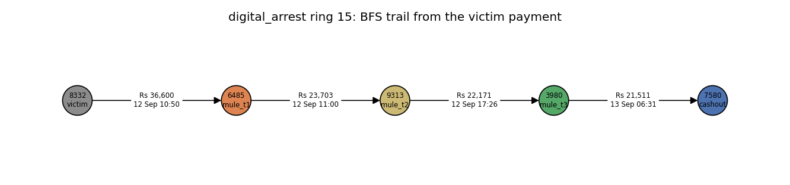
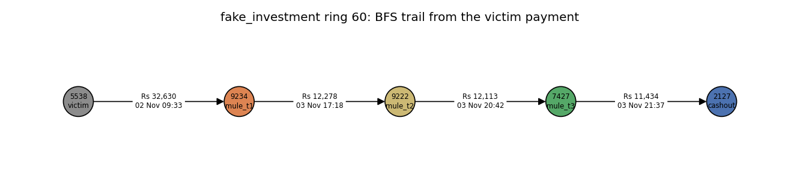
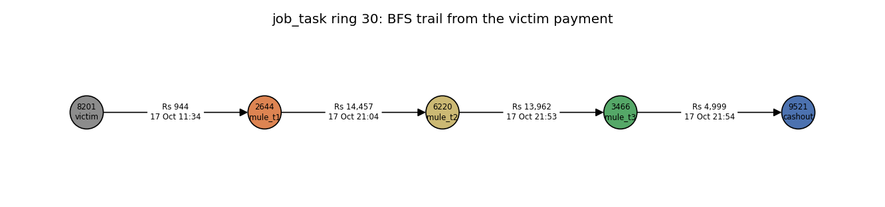
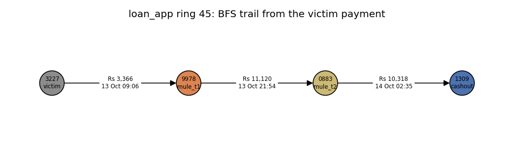
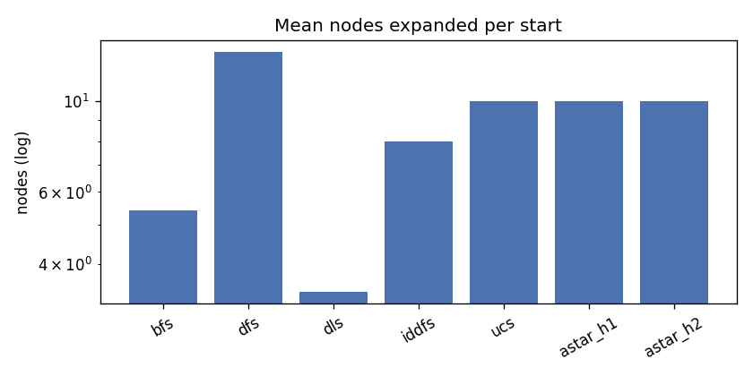
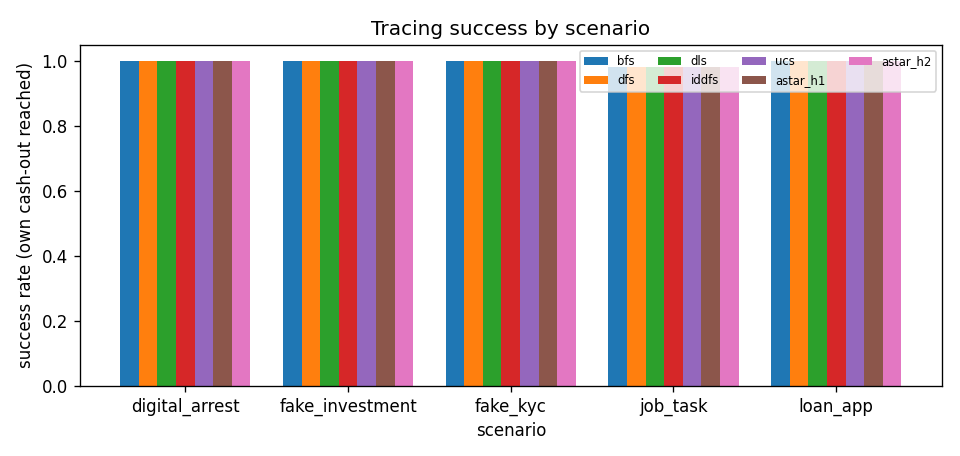

# Tracing stolen money: uninformed and informed search

## Summary

Real transaction data is legally unavailable; we built a simulator calibrated to NPCI/RBI statistics and validated against the IBM AML benchmark.

Data: **real** (50,377 accounts, 1,803,905 transactions, 75 rings, 2,278 victim-payment starts). Generated by `python -m mulehunt.trace`.

- BFS reaches the ring's own cash-out from 99.5% of starts.
- Search vs classifier (all trails <= 6 hops): the random forest flags 309 of 455 mules (recall 0.679); trails from the victim payments find 455 (1.000), 146 of them missed by the classifier, for a combined recall of 1.000. The cost: 1 genuine accounts lie on those trails. For `fake_kyc`, the random forest flags 32 of 92 mules (recall 0.35); trails find 92 (1.00), 60 of which the classifier missed.

## Problem formulation

**States.** `(account, arrival_time)`: which account holds the traced money, and since when.
The same account reached at two different times is two different states, because the time
decides which onward payments are possible.

**Initial state (B-D3).** A flagged victim payment: the state right after a victim to tier-1
mule payment lands, `(receiver, timestamp)`.

**Actions / transition.** From `(u, t)`, follow any payment `u -> v` at time `t'` with
`t < t' <= t + W`, giving the state `(v, t')`. `W` is the hop window (B-D2, 48 h): Person A's
simulator caps every hop at 48 h, and patient mules wait 24-47 h.

**Goal test (B-D1).** The account is a known cash-out (`role == "cashout"` in `accounts.csv`,
as if the bank had seen the cash withdrawal). This is the single ground-truth read in search
logic; everything else (tiers, ring membership, scenario) is used only to score the results.

**Path cost.** Hops for BFS / DFS / DLS / IDDFS; `-log(risk_prob of the receiver)` per edge
(B-D4) for UCS and A*, so the cheapest trail is the one whose accounts the classifier finds
most suspicious overall (the product of the risks is largest).

## The time-respecting rule

Worked example (it is a unit test in `tests/search/test_b_graph.py`): money lands at account B
at 00:00. B then pays C at 00:00 (same instant: illegal, the money had not arrived "before"),
D at 10:00 (legal), E at exactly 48:00 later (legal, the boundary is inclusive) and F at
48:00:36 (illegal, outside the window). So `successors(B, 00:00) = [D, E]`.

Why the rule matters: a static graph would let a search follow a payment that happened
*before* the stolen money arrived, which cannot be carrying that money. The time rule also
makes every trail strictly increasing in time, so a tree search can never loop.

## Example trails

One BFS trail per scenario (first hop = the victim payment); nodes coloured by true tier from `rings.json`.

## Algorithms and conventions

| Algorithm | Frontier | Goal test | Complete? | Optimal? |
|---|---|---|---|---|
| BFS | FIFO queue, graph search (reached set of states) | at generation | yes | fewest hops |
| DFS | LIFO stack, tree search, successors in time order | at generation | yes here (time strictly increases, finite) | no |
| DLS (6) | DFS with depth limit | at generation | only within the limit | no |
| IDDFS (<= 8) | DLS with limit 1, 2, ... | at generation | yes (up to max depth) | fewest hops |
| UCS | priority queue on g | at pop | yes | cheapest cost |
| A* | priority queue on g + h | at pop | yes | cheapest cost if h admissible |

- Every run has a budget of `MAX_EXPANSIONS = 200,000` expansions. A run that hits
  it is reported as **truncated**, never as "not found".
- `cutoff` distinguishes "the depth limit stopped a branch" from "there is no trail".
- `peak_stored` (frontier + reached/visited states at their largest) is the deterministic
  memory measure. Tree-search DFS/DLS/IDDFS store only the stack; BFS stores every reached state.
- Several victim payments can reach the same `(account, time)` state. Tree search re-expands it,
  graph search does not, so their node counts differ; both are documented choices.
- Cash-out accounts are terminal: once a goal is reached, it is not expanded further.

## Comparison over every start

`success_rate` = the ring's own cash-out was reached; `trail_precision` = share of trail accounts (after the start) that belong to the ring; times are in `b_tables/search_timing.csv`.

| algorithm | starts | success_rate | found_any_rate | mean_expanded | median_expanded | mean_peak_stored | mean_hops | trail_precision | truncated |
|---|---|---|---|---|---|---|---|---|---|
| bfs | 2278 | 0.9947 | 0.9947 | 5.412 | 5 | 28.31 | 2.749 | 1 | 0 |
| dfs | 2278 | 0.9947 | 0.9947 | 13.21 | 3 | 7.959 | 2.754 | 0.9999 | 0 |
| dls | 2278 | 0.9947 | 0.9947 | 3.413 | 3 | 7.719 | 2.754 | 0.9999 | 0 |
| iddfs | 2278 | 0.9947 | 0.9947 | 7.97 | 8 | 7.977 | 2.749 | 1 | 0 |
| ucs | 2278 | 0.9947 | 0.9947 | 10.04 | 8 | 26.67 | 2.749 | 1 | 0 |
| astar_h1 | 2278 | 0.9947 | 0.9947 | 10.04 | 8 | 26.67 | 2.749 | 1 | 0 |
| astar_h2 | 2278 | 0.9947 | 0.9947 | 10.04 | 8 | 26.67 | 2.749 | 1 | 0 |

Ring level (share of rings traced from at least one start):

| algorithm | rings_traced |
|---|---|
| bfs | 1 |
| dfs | 1 |
| dls | 1 |
| iddfs | 1 |
| ucs | 1 |
| astar_h1 | 1 |
| astar_h2 | 1 |

## By scenario, evasive and cycle rings

| scenario | algorithm | success_rate | mean_expanded | trail_precision |
|---|---|---|---|---|
| digital_arrest | astar_h1 | 1 | 11.41 | 1 |
| digital_arrest | astar_h2 | 1 | 11.41 | 1 |
| digital_arrest | bfs | 1 | 10.99 | 1 |
| digital_arrest | dfs | 1 | 5.363 | 1 |
| digital_arrest | dls | 1 | 3.736 | 1 |
| digital_arrest | iddfs | 1 | 13.44 | 1 |
| digital_arrest | ucs | 1 | 11.41 | 1 |
| fake_investment | astar_h1 | 1 | 18.69 | 1 |
| fake_investment | astar_h2 | 1 | 18.69 | 1 |
| fake_investment | bfs | 1 | 8.005 | 1 |
| fake_investment | dfs | 1 | 3.58 | 0.9989 |
| fake_investment | dls | 1 | 3.181 | 0.9989 |
| fake_investment | iddfs | 1 | 10.69 | 1 |
| fake_investment | ucs | 1 | 18.69 | 1 |
| fake_kyc | astar_h1 | 1 | 4.625 | 1 |
| fake_kyc | astar_h2 | 1 | 4.625 | 1 |
| fake_kyc | bfs | 1 | 5.75 | 1 |
| fake_kyc | dfs | 1 | 2.688 | 1 |
| fake_kyc | dls | 1 | 2.688 | 1 |
| fake_kyc | iddfs | 1 | 8 | 1 |
| fake_kyc | ucs | 1 | 4.625 | 1 |
| job_task | astar_h1 | 0.9828 | 7.542 | 1 |
| job_task | astar_h2 | 0.9828 | 7.542 | 1 |
| job_task | bfs | 0.9828 | 5.122 | 1 |
| job_task | dfs | 0.9828 | 4.362 | 1 |
| job_task | dls | 0.9828 | 3.727 | 1 |
| job_task | iddfs | 0.9828 | 7.863 | 1 |
| job_task | ucs | 0.9828 | 7.542 | 1 |
| loan_app | astar_h1 | 0.9986 | 9.896 | 1 |
| loan_app | astar_h2 | 0.9986 | 9.896 | 1 |
| loan_app | bfs | 0.9986 | 4.819 | 1 |
| loan_app | dfs | 0.9986 | 18.82 | 1 |
| loan_app | dls | 0.9986 | 3.301 | 1 |
| loan_app | iddfs | 0.9986 | 7.294 | 1 |
| loan_app | ucs | 0.9986 | 9.896 | 1 |

By split:

| split | algorithm | success_rate | mean_expanded | trail_precision |
|---|---|---|---|---|
| test | astar_h1 | 0.9879 | 12.23 | 1 |
| test | astar_h2 | 0.9879 | 12.23 | 1 |
| test | bfs | 0.9879 | 6.287 | 1 |
| test | dfs | 0.9879 | 3.908 | 1 |
| test | dls | 0.9879 | 3.367 | 1 |
| test | iddfs | 0.9879 | 9.042 | 1 |
| test | ucs | 0.9879 | 12.23 | 1 |
| train | astar_h1 | 0.9961 | 9.161 | 1 |
| train | astar_h2 | 0.9961 | 9.161 | 1 |
| train | bfs | 0.9961 | 5.442 | 1 |
| train | dfs | 0.9961 | 25.21 | 1 |
| train | dls | 0.9961 | 3.732 | 1 |
| train | iddfs | 0.9961 | 8.136 | 1 |
| train | ucs | 0.9961 | 9.161 | 1 |
| val | astar_h1 | 1 | 9.123 | 1 |
| val | astar_h2 | 1 | 9.123 | 1 |
| val | bfs | 1 | 4.397 | 1 |
| val | dfs | 1 | 3.163 | 0.9997 |
| val | dls | 1 | 2.925 | 0.9997 |
| val | iddfs | 1 | 6.507 | 1 |
| val | ucs | 1 | 9.123 | 1 |

Evasive rings (split payments under thresholds):

| evasive | algorithm | success_rate | mean_expanded | trail_precision |
|---|---|---|---|---|
| FAIL | astar_h1 | 0.9944 | 9.555 | 1 |
| FAIL | astar_h2 | 0.9944 | 9.555 | 1 |
| FAIL | bfs | 0.9944 | 5.188 | 1 |
| FAIL | dfs | 0.9944 | 13.74 | 1 |
| FAIL | dls | 0.9944 | 3.398 | 1 |
| FAIL | iddfs | 0.9944 | 7.747 | 1 |
| FAIL | ucs | 0.9944 | 9.555 | 1 |
| PASS | astar_h1 | 1 | 17.49 | 1 |
| PASS | astar_h2 | 1 | 17.49 | 1 |
| PASS | bfs | 1 | 8.843 | 1 |
| PASS | dfs | 1 | 5.171 | 0.9986 |
| PASS | dls | 1 | 3.65 | 0.9986 |
| PASS | iddfs | 1 | 11.37 | 1 |
| PASS | ucs | 1 | 17.49 | 1 |

Rings with a cycle among tier-2 mules:

| cycle | algorithm | success_rate | mean_expanded | trail_precision |
|---|---|---|---|---|
| FAIL | astar_h1 | 0.9946 | 9.629 | 1 |
| FAIL | astar_h2 | 0.9946 | 9.629 | 1 |
| FAIL | bfs | 0.9946 | 5.273 | 1 |
| FAIL | dfs | 0.9946 | 13.49 | 1 |
| FAIL | dls | 0.9946 | 3.421 | 1 |
| FAIL | iddfs | 0.9946 | 7.829 | 1 |
| FAIL | ucs | 0.9946 | 9.629 | 1 |
| PASS | astar_h1 | 1 | 25.33 | 1 |
| PASS | astar_h2 | 1 | 25.33 | 1 |
| PASS | bfs | 1 | 10.55 | 1 |
| PASS | dfs | 1 | 3.133 | 0.9967 |
| PASS | dls | 1 | 3.133 | 0.9967 |
| PASS | iddfs | 1 | 13.2 | 1 |
| PASS | ucs | 1 | 25.33 | 1 |

## Search vs classifier

For each ring: mules (tiers 1-3) on found trails, mules the random forest flags at its validation-F1 threshold (0.484), and mules found **only** by the trail. `genuine_on_trails` counts accounts outside every ring that the trails pass through: the false-alarm cost of following money. The all-trails variant collects every account on any time-respecting trail of at most 6 hops to a cash-out (0 start(s) hit the expansion budget).

| scenario | trails | mules | trail_mules | rf_flagged | trail_only | either | genuine_on_trails | rf_recall | trail_recall | combined_recall |
|---|---|---|---|---|---|---|---|---|---|---|
| digital_arrest | BFS trail per start | 88 | 66 | 65 | 13 | 78 | 0 | 0.739 | 0.75 | 0.886 |
| fake_investment | BFS trail per start | 95 | 94 | 83 | 12 | 95 | 0 | 0.874 | 0.989 | 1 |
| fake_kyc | BFS trail per start | 92 | 39 | 32 | 28 | 60 | 0 | 0.348 | 0.424 | 0.652 |
| job_task | BFS trail per start | 95 | 93 | 54 | 40 | 94 | 0 | 0.568 | 0.979 | 0.989 |
| loan_app | BFS trail per start | 85 | 85 | 75 | 10 | 85 | 0 | 0.882 | 1 | 1 |
| all | BFS trail per start | 455 | 377 | 309 | 103 | 412 | 0 | 0.679 | 0.829 | 0.905 |
| digital_arrest | all trails <= 6 hops | 88 | 88 | 65 | 23 | 88 | 0 | 0.739 | 1 | 1 |
| fake_investment | all trails <= 6 hops | 95 | 95 | 83 | 12 | 95 | 1 | 0.874 | 1 | 1 |
| fake_kyc | all trails <= 6 hops | 92 | 92 | 32 | 60 | 92 | 0 | 0.348 | 1 | 1 |
| job_task | all trails <= 6 hops | 95 | 95 | 54 | 41 | 95 | 0 | 0.568 | 1 | 1 |
| loan_app | all trails <= 6 hops | 85 | 85 | 75 | 10 | 85 | 0 | 0.882 | 1 | 1 |
| all | all trails <= 6 hops | 455 | 455 | 309 | 146 | 455 | 1 | 0.679 | 1 | 1 |

## Window sensitivity

BFS success with shorter hop windows. Patient mules wait 24-47 h, so trails through them are lost at 12 h and 24 h.

| window_h | starts | success_rate |
|---|---|---|
| 12 | 2278 | 0.651 |
| 24 | 2278 | 0.8279 |
| 48 | 2278 | 0.9947 |

Rings whose longest in-ring hop gap exceeds 24 h: 70 of 75; exceeds 12 h: 75 (`b_tables/search_hop_gaps.csv`).

## A* heuristics

**h1 (plan): `h1(n) = m * d(n)`.** `d(n)` is the reverse-BFS hop distance from account `n` to
the nearest goal in the *static* graph (time ignored). Every time-respecting trail is also a
static path, so the true number of remaining hops is at least `d(n)`. Every edge on a
goal-bound trail enters an account that can still reach a goal, and `m` is the minimum cost
over exactly those entries, so each remaining hop costs at least `m`. Hence
`h1(n) <= h*(n)`: **admissible**. **Consistent:** for an edge `n -> n'`, `d(n) <= d(n') + 1`, so
`h1(n) - h1(n') <= m <= cost(n -> n')`. Accounts with no static route to a goal get `h = inf`
and are pruned (no trail can exist).

**h2 (layered, PROPOSAL): `h2(n) = sum_{j=0}^{d(n)-1} L_j`**, with
`L_j = min{ cost into account a : d(a) = j }`. One hop lowers `d` by at most 1 and a trail ends at
`d = 0`, so a trail from `n` must contain receivers at every distance `d(n)-1, ..., 0`, each at a
different position on the trail. Its cost is therefore at least the cheapest entry into each
of those layers: `h2(n) <= h*(n)`, **admissible**. **Consistent:** for `n -> n'`, if
`d(n') = d(n) - 1` then `h2(n) - h2(n') = L_{d(n)-1} <= cost(n -> n')` (the receiver `n'` is in
layer `d(n)-1`); if `d(n') >= d(n)` then `h2(n') >= h2(n)` and the inequality holds trivially.
Since every `L_j >= m`, `h2 >= h1` everywhere: h2 is never weaker.

**Why h1 is weak here.** The most suspicious account in `models/risk_scores.csv` has risk
0.99985, so `m = -log(0.99985) ~ 1.5e-4`: h1 is almost zero and A*(h1) behaves like UCS. The
layered bound uses the cheapest entry *per layer*, and the layers far from any cash-out contain
no near-certain account, so h2 is much larger there.

Measured values of `m` and the layer minima `L_j`:

| quantity | value |
|---|---|
| m (h1 slope) | 0.000152062 |
| L_0 | 0.000775751 |
| L_1 | 0.000152062 |
| L_2 | 0.000769456 |
| L_3 | 0.00394291 |
| L_4 | 0.338069 |
| L_5 | 1.18395 |

UCS vs A*(h1) vs A*(h2) over every start (expansions and agreement of the found cost, 1e-9 tolerance):

| algorithm | mean_expanded | total_expanded | cost_agrees_with_ucs | expanded_vs_ucs |
|---|---|---|---|---|
| ucs | 10.04 | 22876 | 1 | 1 |
| astar_h1 | 10.04 | 22876 | 1 | 1 |
| astar_h2 | 10.04 | 22876 | 1 | 1 |

Measured: A*(h1) expands 100.0% and A*(h2) 100.0% of UCS's nodes. Victim payments start 2-3 hops from a cash-out, and the layers 0-2 each contain a ring account the classifier scores near 1, so h2 at a start is at most 0.0017, too small to reorder the frontier. Both heuristics are admissible (checked on every toy start in the tests) but uninformative on this data; h2 only helps for states far from every cash-out, where L_4 and L_5 are large.

What A* adds: on starts where both reach the own cash-out, BFS returns the fewest-hop trail while A* returns the trail with the lowest summed `-log(risk)`, i.e. the most suspicious one.

| trail | starts | mean_hops | mean_neg_log_risk_cost | trail_precision | same_trail_share |
|---|---|---|---|---|---|
| BFS (fewest hops) | 2266 | 2.749 | 0.4367 | 1 | 0.6359 |
| A* h2 (most suspicious) | 2266 | 2.749 | 0.3363 | 1 | 0.6359 |

## Limitations

- **B-D1 assumption:** the goal set is the true cash-out accounts, as if the bank had seen every
  withdrawal. In practice the goal set would be partial; the optional label-free "sink" goal
  (Task 3 Step 5) was not built in this version.
- **Budgets:** `MAX_EXPANSIONS = 200,000`; truncated runs are counted separately.
- **Sleepers and money collectors:** mules with normal history and benign forwarders create
  legal branches, which is why DFS wanders and why genuine accounts appear on the all-trails sets.
- **Score windows:** `risk_prob` describes each account inside its own split window. Rings are
  split-pure, but genuine accounts on a trail may come from any split.
- **Simulated data:** the rings come from Person A's simulator, not real UPI data.

## Parameters used

| parameter | value |
|---|---|
| GOAL_ROLE | cashout |
| HOP_WINDOW_H | 48 |
| WINDOW_SENSITIVITY_H | (12, 24, 48) |
| DEFAULT_RISK | 0.05 |
| DLS_LIMIT | 6 |
| MAX_DEPTH | 8 |
| MAX_EXPANSIONS | 200000 |
