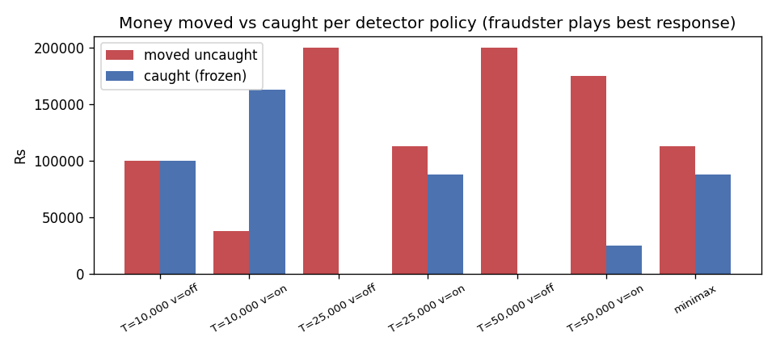
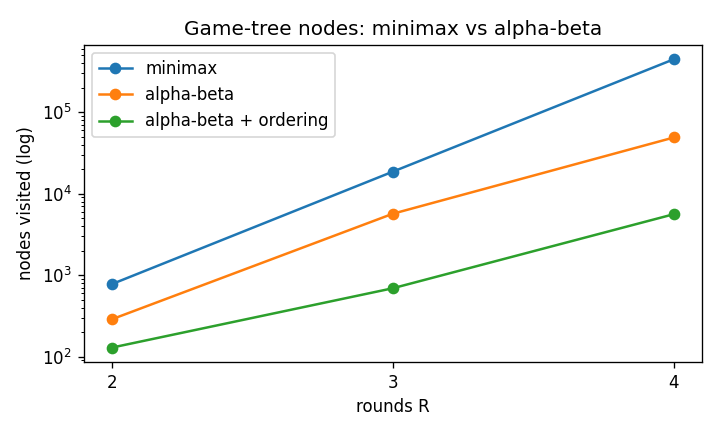
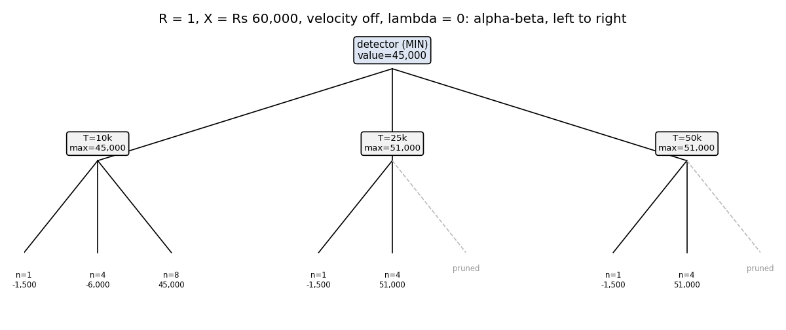

# Fraudster vs detector: minimax and alpha-beta

## Summary

Real transaction data is legally unavailable; we built a simulator calibrated to NPCI/RBI statistics and validated against the IBM AML benchmark.

Data for the false-alarm rates: **real**. Generated by `python -m mulehunt.adversarial`.

- Every fixed rule is undercut by splitting wherever the move set allows it: the fraudster's best response keeps each part below T. At T = 10k the first round (at least Rs 1 lakh in at most 8 parts) cannot get under, so he sends it as one part (one fee) and accepts that it is frozen.
- The minimax value of the R = 3 game is **Rs 114,272** for the fraudster (detector's first rule:
  T = 25,000, velocity on).
- Alpha-beta with move ordering visits 691 nodes instead of 18,631
  (96.3% fewer) and returns the same value and move.

## The game

- **Players:** detector (MIN) and fraudster (MAX); zero-sum.
- **Setup (B-D7):** move X = Rs 200,000 over R = 3 rounds (days).
- **Detector move (B-D8):** threshold T in (10000, 25000, 50000) x velocity rule off/on. With velocity on,
  every part after the first 3 sent in a round is flagged.
- **Fraudster move (B-D9):** fraction f in (0.5, 1.0) of the remaining money (forced to 1.0 in the last
  round) x n in (1, 2, 4, 8) equal parts, each through a different tier-1 mule.
- **Catching:** a part is caught if it is >= T, or if velocity is on and it is beyond the first 3.
  Caught money is frozen.
- **Payoff (B-D10, B-D11):** per round, `moved - caught - n x 1,500 - 5% x
  moved_uncaught + lambda x FA(T, v)`, with lambda = Rs 100 per false alert. Money not moved by
  the last round counts 0.
- **Why the FA term:** without it, the strictest rule (10k + velocity) always wins and the game is trivial.
  It does not depend on the fraudster's move, so his best response is unchanged.
- **Depth-limited evaluation (B-D12):** `remaining x (1 - commission) - fee`, optimistic for the fraudster.
- **Move ordering:** fraudster moves by immediate payoff, descending; detector rules by the fraudster's best
  immediate payoff against them, ascending (the most restrictive rule first). This is a slight variant of
  the plan's "money caught" key; it orders the same way when false-alarm costs are equal.

## Measured false alarms

Mean alerts per day on genuine (`scenario == normal`) transactions:

| threshold | velocity | alerts_per_day | cost_per_round_at_lambda |
|---|---|---|---|
| 10000 | FAIL | 370.1 | 37,012 |
| 10000 | PASS | 442.6 | 44,261 |
| 25000 | FAIL | 32.17 | 3,217 |
| 25000 | PASS | 104.7 | 10,466 |
| 50000 | FAIL | 3.73 | 373 |
| 50000 | PASS | 76.22 | 7,622 |

## 1. A fixed threshold is beaten

| detector_rule | game_value | fraudster_plan (f, n) per round | uncaught | caught | fees | fa_cost |
|---|---|---|---|---|---|---|
| T=10,000 v=off | 180,537 | (0.5,1) (0.5,8) (1,8) | 100,000 | 100,000 | 30,500 | 111,037 |
| T=10,000 v=on | 142,908 | (0.5,1) (0.5,8) (1,8) | 37,500 | 162,500 | 27,375 | 132,783 |
| T=25,000 v=off | 175,650 | (0.5,8) (0.5,4) (1,4) | 200,000 | 0 | 34,000 | 9,650 |
| T=25,000 v=on | 114,272 | (0.5,8) (0.5,4) (1,4) | 112,500 | 87,500 | 29,625 | 31,397 |
| T=50,000 v=off | 179,120 | (0.5,4) (0.5,2) (1,2) | 200,000 | 0 | 22,000 | 1,120 |
| T=50,000 v=on | 177,117 | (0.5,4) (0.5,2) (1,2) | 175,000 | 25,000 | 20,750 | 22,867 |

29% of Person A's simulated rings are evasive (they split payments to 90-99.9% of a threshold), and the `below_threshold_share` feature averages 0.036 for fraud accounts vs 0.005 for genuine ones. The game explains why: against any fixed threshold, splitting is the best response.

## 2. The minimax policy

Play-out with both sides playing minimax (value Rs 114,272):

| round | remaining_before | threshold | velocity | fraction | parts | moved | caught | uncaught | fees | commission | fa_cost | payoff |
|---|---|---|---|---|---|---|---|---|---|---|---|---|
| 1 | 200,000 | 25000 | PASS | 0.5 | 8 | 100,000 | 62,500 | 37,500 | 12000 | 1,875 | 10,466 | 34,091 |
| 2 | 100,000 | 25000 | PASS | 0.5 | 4 | 50,000 | 12,500 | 37,500 | 6000 | 1,875 | 10,466 | 40,091 |
| 3 | 50,000 | 25000 | PASS | 1 | 4 | 50,000 | 12,500 | 37,500 | 6000 | 1,875 | 10,466 | 40,091 |

Accounting: uncaught 112,500 + caught 87,500 + left over 0 = 200,000 (= X).

## 3. Node counts

| R | method | nodes | cutoffs | value | first_rule |
|---|---|---|---|---|---|
| 2 | minimax | 775 | 0 | 68,181 | (25000, True) |
| 2 | alpha-beta | 287 | 61 | 68,181 | (25000, True) |
| 2 | alpha-beta + ordering | 129 | 36 | 68,181 | (25000, True) |
| 3 | minimax | 18631 | 0 | 114,272 | (25000, True) |
| 3 | alpha-beta | 5675 | 797 | 114,272 | (25000, True) |
| 3 | alpha-beta + ordering | 691 | 190 | 114,272 | (25000, True) |
| 4 | minimax | 447175 | 0 | 119,428 | (25000, True) |
| 4 | alpha-beta | 48996 | 12469 | 119,428 | (25000, True) |
| 4 | alpha-beta + ordering | 5606 | 1160 | 119,428 | (25000, True) |

## 4. Lambda sweep

How the detector's minimax rule changes with the false-alarm price:

| lambda | game_value | detector_rules_by_round | uncaught | caught |
|---|---|---|---|---|
| 0 | 10,125 | 10k/off 10k/on 10k/on | 37,500 | 162,500 |
| 25 | 41,509 | 10k/off 10k/on 10k/on | 37,500 | 162,500 |
| 100 | 114,272 | 25k/on 25k/on 25k/on | 112,500 | 87,500 |
| 400 | 157,474 | 25k/on 50k/off 50k/off | 137,500 | 62,500 |

## 5. Deep game

R = 6 with depth limits and the evaluation function (alpha-beta + ordering). Timings are in `b_tables/game_deep_timing.csv`.

| R | depth_plies | value | first_rule | nodes | cutoffs |
|---|---|---|---|---|---|
| 6 | 4 | 120,181 | (25000, True) | 183 | 37 |
| 6 | 6 | 119,054 | (25000, True) | 1192 | 202 |
| 6 | 8 | 119,428 | (25000, True) | 8040 | 1197 |

## Viva caveat

Real detectors commit to a policy first and fraudsters adapt, which is exactly this move order;
minimax gives the detector its worst-case-safe policy. It is a simplified model: discrete
moves, equal parts, no learning, a fixed false-alarm price, and catching is all-or-nothing
per part.

## Parameters used

| parameter | value |
|---|---|
| GAME_X | 200000 |
| GAME_R | 3 |
| DEEP_R | 6 |
| DEEP_DEPTHS | (4, 6, 8) |
| GAME_THRESHOLDS | (10000, 25000, 50000) |
| VELOCITY_K | 3 |
| FRACTIONS | (0.5, 1.0) |
| PARTS | (1, 2, 4, 8) |
| MULE_FEE | 1500 |
| COMMISSION | 0.05 |
| ALERT_COST | 100 |
| ALERT_COST_SWEEP | (0, 25, 100, 400) |
