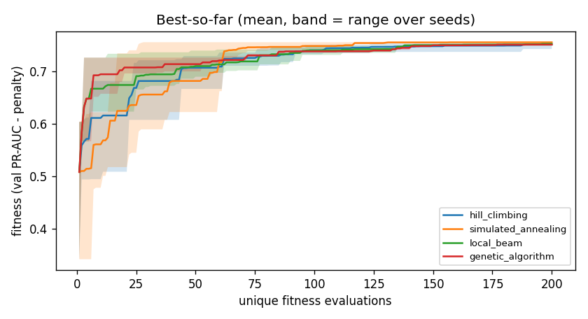
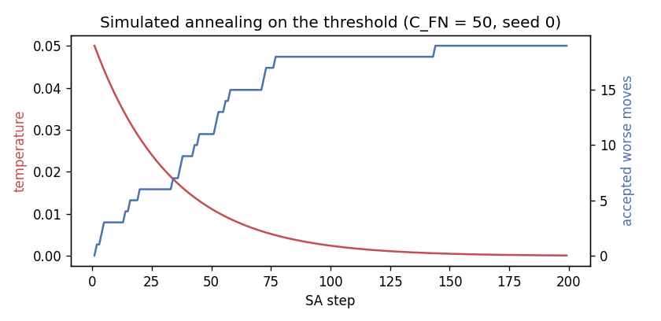

# Local search: feature selection and threshold tuning

## Summary

Real transaction data is legally unavailable; we built a simulator calibrated to NPCI/RBI statistics and validated against the IBM AML benchmark.

Generated by `python -m mulehunt.local_search`. Tuning uses the validation split only; each study
reports a single test-split number.

- **Feature selection:** the best subset (hill_climbing, seed 1) keeps 11 of 20 features with
  validation PR-AUC 0.7784 (all 20 features: 0.7560). Refit on train,
  its **test PR-AUC is 0.8159** (reported once).
- **Threshold tuning (C_FN = 50):** simulated annealing picks t = 0.1228; on test it costs
  617 (FN 8, FP 217, recall 0.953) vs 2,105 at Person A's
  F1 threshold 0.484 (recall 0.753).

## Algorithms

All four share one interface (`Problem`: random solution, neighbours, fitness, crossover, mutation)
and one budget of `EVAL_BUDGET = 200` **unique** fitness evaluations, counted by a memoising cache.

- **Hill climbing:** steepest ascent over all neighbours; on a local optimum it restarts from a random
  solution until the budget is spent (random-restart hill climbing).
- **Simulated annealing:** random neighbour; a worse move is accepted with probability `exp(delta / T)`;
  `T` starts at 0.05 and is multiplied by 0.97 per step.
- **Local beam (stochastic):** k = 4 states; each draws |neighbourhood| / k random successors, the
  pool is ranked and the best k kept; restarts when the beam stops improving. The full-neighbourhood
  version costs k x 20 evaluations per step and cannot climb within the budget.
- **Genetic algorithm:** population 20, tournament size 3, crossover rate 0.9
  (one-point for bitstrings, blend BLX-0.25 for thresholds), mutation 0.05 per bit (Gaussian for
  thresholds), one elite kept.

## Feature selection

Solution: a 20-bit string in `FEATURE_COLUMNS` order. Fitness (B-D13): validation PR-AUC of
`mulehunt.models.make_baseline_lr()` fitted on train with the selected columns, minus
0.002 per feature; the empty set scores -1. Fit and run times are in `b_tables/local_fs_timing.csv`.

Per algorithm (over seeds):

| algorithm | mean_best_fitness | max_best_fitness | mean_val_pr_auc | mean_features | mean_evals_to_99pct |
|---|---|---|---|---|---|
| hill_climbing | 0.7519 | 0.7564 | 0.7739 | 11 | 106 |
| simulated_annealing | 0.7562 | 0.7564 | 0.7782 | 11 | 79.33 |
| local_beam | 0.7534 | 0.7558 | 0.776 | 11.33 | 118.3 |
| genetic_algorithm | 0.7518 | 0.7536 | 0.7765 | 12.33 | 136.3 |

Every run:

| algorithm | seed | best_fitness | val_pr_auc | n_features | evals | evals_to_99pct | features |
|---|---|---|---|---|---|---|---|
| hill_climbing | 0 | 0.7434 | 0.7654 | 11 | 200 | 124 | total_inflow total_outflow pass_through_ratio in_degree out_degree new_counterparty_share fan_out_max_24h neighbor_suspicious_share txn_count below_threshold_share has_large_receipt |
| hill_climbing | 1 | 0.7564 | 0.7784 | 11 | 200 | 116 | total_inflow total_outflow pass_through_ratio in_degree out_degree new_counterparty_share fan_out_max_24h neighbor_suspicious_share txn_count night_txn_share below_threshold_share |
| hill_climbing | 2 | 0.7558 | 0.7778 | 11 | 200 | 78 | total_inflow pass_through_ratio in_degree out_degree new_counterparty_share fan_out_max_24h neighbor_suspicious_share txn_count night_txn_share below_threshold_share account_age_at_first_large_receipt_days |
| simulated_annealing | 0 | 0.7558 | 0.7778 | 11 | 173 | 117 | total_inflow pass_through_ratio in_degree out_degree new_counterparty_share fan_out_max_24h neighbor_suspicious_share txn_count night_txn_share below_threshold_share account_age_at_first_large_receipt_days |
| simulated_annealing | 1 | 0.7564 | 0.7784 | 11 | 174 | 95 | total_inflow total_outflow pass_through_ratio in_degree out_degree new_counterparty_share fan_out_max_24h neighbor_suspicious_share txn_count night_txn_share below_threshold_share |
| simulated_annealing | 2 | 0.7564 | 0.7784 | 11 | 143 | 26 | total_inflow total_outflow pass_through_ratio in_degree out_degree new_counterparty_share fan_out_max_24h neighbor_suspicious_share txn_count night_txn_share below_threshold_share |
| local_beam | 0 | 0.7544 | 0.7764 | 11 | 200 | 138 | total_inflow total_outflow pass_through_ratio in_degree out_degree new_counterparty_share fan_out_max_24h neighbor_suspicious_share txn_count night_txn_share account_age_at_first_large_receipt_days |
| local_beam | 1 | 0.7558 | 0.7778 | 11 | 200 | 135 | total_inflow pass_through_ratio in_degree out_degree new_counterparty_share fan_out_max_24h neighbor_suspicious_share txn_count night_txn_share below_threshold_share account_age_at_first_large_receipt_days |
| local_beam | 2 | 0.7499 | 0.7739 | 12 | 200 | 82 | pass_through_ratio avg_dwell_hours in_degree out_degree new_counterparty_share fan_out_max_24h txn_count night_txn_share below_threshold_share burstiness has_large_receipt device_shared_accounts |
| genetic_algorithm | 0 | 0.7519 | 0.7779 | 13 | 200 | 133 | total_inflow total_outflow pass_through_ratio in_degree out_degree new_counterparty_share fan_out_max_24h neighbor_suspicious_share txn_count night_txn_share round_amount_share account_age_at_first_large_receipt_days device_shared_accounts |
| genetic_algorithm | 1 | 0.7536 | 0.7776 | 12 | 200 | 141 | total_inflow pass_through_ratio in_degree out_degree new_counterparty_share fan_in_max_24h fan_out_max_24h neighbor_suspicious_share txn_count night_txn_share below_threshold_share account_age_at_first_large_receipt_days |
| genetic_algorithm | 2 | 0.7499 | 0.7739 | 12 | 200 | 135 | pass_through_ratio avg_dwell_hours in_degree out_degree new_counterparty_share fan_out_max_24h txn_count night_txn_share below_threshold_share burstiness has_large_receipt device_shared_accounts |

Baseline:

| subset | n_features | val_pr_auc | fitness |
|---|---|---|---|
| all 20 features | 20 | 0.756 | 0.716 |

Person A's per-group ablation (random forest), for comparison:

| features | n_features | test_pr_auc | test_f1 | test_recall_at_1pct_fpr |
|---|---|---|---|---|
| transaction_only | 14 | 0.8348 | 0.7883 | 0.8353 |
| with_network | 20 | 0.9208 | 0.8862 | 0.9412 |

Test split, once: best subset `total_inflow total_outflow pass_through_ratio in_degree out_degree new_counterparty_share fan_out_max_24h neighbor_suspicious_share txn_count night_txn_share below_threshold_share` refit on train gives test PR-AUC **0.8159**.

## Threshold tuning

Solution: a threshold t in [0, 1] on the random forest's validation probabilities. Cost (B-D15) =
`C_FN x FN + C_FP x FP` with C_FP = 1; fitness = -cost / (C_FN x positives). Neighbour:
`clip(t + N(0, 0.05))`.

**Why a 1-D problem is still a fair demonstration:** the exact answer can be found by scanning every
distinct probability as a candidate threshold, so each local-search method can be *checked*
against the true optimum (`gap_vs_exact` = relative extra cost).

| C_FN | algorithm | mean_threshold | mean_val_cost | worst_gap_vs_exact | exact_threshold | exact_val_cost |
|---|---|---|---|---|---|---|
| 10 | hill_climbing | 0.2272 | 269.7 | 0.0112 | 0.2104 | 268 |
| 10 | simulated_annealing | 0.2098 | 269 | 0.0037 | 0.2104 | 268 |
| 10 | local_beam | 0.2098 | 269 | 0.0037 | 0.2104 | 268 |
| 10 | genetic_algorithm | 0.2275 | 269.7 | 0.0075 | 0.2104 | 268 |
| 50 | hill_climbing | 0.1218 | 845.7 | 0.0048 | 0.1231 | 842 |
| 50 | simulated_annealing | 0.1226 | 843.7 | 0.0036 | 0.1231 | 842 |
| 50 | local_beam | 0.1226 | 844 | 0.0036 | 0.1231 | 842 |
| 50 | genetic_algorithm | 0.1228 | 843 | 0.0012 | 0.1231 | 842 |
| 100 | hill_climbing | 0.1218 | 1,396 | 0.0029 | 0.1231 | 1,392 |
| 100 | simulated_annealing | 0.1224 | 1,394 | 0.0022 | 0.1231 | 1,392 |
| 100 | local_beam | 0.1226 | 1,394 | 0.0022 | 0.1231 | 1,392 |
| 100 | genetic_algorithm | 0.1204 | 1,399 | 0.0108 | 0.1231 | 1,392 |

Test split, once (headline ratio):

| threshold_source | threshold | test_cost | FN | FP | precision | recall |
|---|---|---|---|---|---|---|
| SA threshold (headline) | 0.1228 | 617 | 8 | 217 | 0.4274 | 0.9529 |
| exact val optimum | 0.1231 | 617 | 8 | 217 | 0.4274 | 0.9529 |
| Person A's F1 threshold | 0.4844 | 2105 | 42 | 5 | 0.9624 | 0.7529 |

## Parameters used

| parameter | value |
|---|---|
| FEATURE_PENALTY | 0.002 |
| EVAL_BUDGET | 200 |
| SEEDS | (0, 1, 2) |
| BEAM_K | 4 |
| GA_POP | 20 |
| GA_TOURNAMENT | 3 |
| GA_CX_RATE | 0.9 |
| GA_MUT_RATE | 0.05 |
| SA_T0 | 0.05 |
| SA_ALPHA | 0.97 |
| C_FP | 1 |
| C_FN_SWEEP | (10, 50, 100) |
| C_FN_HEADLINE | 50 |
| THRESHOLD_STEP_SD | 0.05 |
