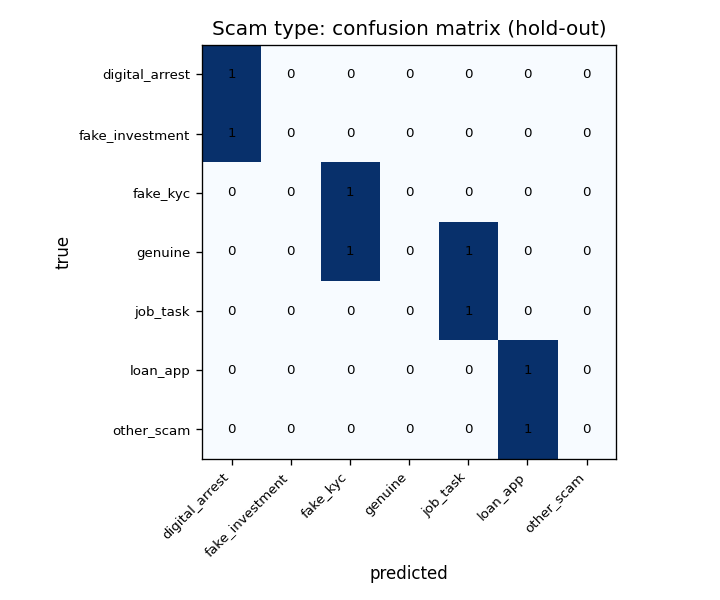

# Scam-message classifier: Naive Bayes

## Summary

**PRELIMINARY: synthetic fixtures.** The real form data is not collected yet; these numbers come from ~36 messages we wrote ourselves (`sample_messages.csv`) and only show that the pipeline works. Rerun `python -m text.classifier` once `messages.csv` exists.

Real transaction data is legally unavailable; we built a simulator calibrated to NPCI/RBI statistics and validated against the IBM AML benchmark. The scam-message dataset is the one fully real dataset in the
project (once collected).

Data: `data/raw/scam_messages/sample_messages.csv`, 36 messages (28 scam, 8 genuine).
Generated by `python -m text.classifier`.

- Binary (scam vs genuine): best model `nb_word`, CV macro-F1 0.470,
  hold-out macro-F1 0.429.
- Multiclass (scam type): best model `lr_tfidf`, CV macro-F1 0.361,
  hold-out macro-F1 0.381.
- Public supplement (B-D17): not used; only 36 own messages, so it applies once real data arrives and stays below 300.

## Dataset

| by | value | messages |
|---|---|---|
| scam_type | genuine | 8 |
| scam_type | fake_kyc | 5 |
| scam_type | digital_arrest | 5 |
| scam_type | job_task | 5 |
| scam_type | loan_app | 5 |
| scam_type | fake_investment | 5 |
| scam_type | other_scam | 3 |
| language | english | 22 |
| language | hinglish | 14 |
| channel | sms | 16 |
| channel | whatsapp | 16 |
| channel | other | 4 |

Classes with fewer than 5 messages merged into `other_scam` for the multiclass task: none.

## Method

- (a) `nb_word`: MultinomialNB on word 1-2-gram counts; (b) `nb_char`: MultinomialNB on `char_wb`
  2-5-gram counts; (c) `nb_word_char`: both, via `FeatureUnion`; (d) `lr_tfidf`: LogisticRegression
  (`class_weight="balanced"`) on TF-IDF word + char features.
- Lowercased; the placeholder tokens are kept (`token_pattern = '(?u)<\\w+>|\\b\\w\\w+\\b'`).
- Stratified 80/20 hold-out by `scam_type` (seed 0); stratified k-fold CV (k = min(5, smallest class))
  on the 80% chooses NB `alpha` in (0.1, 0.3, 1.0) and LR `C` in (0.3, 1.0, 3.0, 10.0) by macro-F1.

## Results: binary

| model | best_params | cv_macro_f1 | holdout_macro_f1 |
|---|---|---|---|
| nb_word | {'model__alpha': 0.1} | 0.47 | 0.429 |
| nb_char | {'model__alpha': 0.1} | 0.44 | 0.429 |
| nb_word_char | {'model__alpha': 0.1} | 0.44 | 0.429 |
| lr_tfidf | {'model__C': 0.3} | 0.44 | 0.429 |

## Results: multiclass

| model | best_params | cv_macro_f1 | holdout_macro_f1 |
|---|---|---|---|
| nb_word | {'model__alpha': 0.3} | 0.346 | 0.438 |
| nb_char | {'model__alpha': 0.1} | 0.164 | 0.405 |
| nb_word_char | {'model__alpha': 0.1} | 0.212 | 0.405 |
| lr_tfidf | {'model__C': 0.3} | 0.361 | 0.381 |

Per class (`lr_tfidf`, hold-out):

| class | precision | recall | f1-score | support |
|---|---|---|---|---|
| digital_arrest | 0.5 | 1 | 0.667 | 1 |
| fake_investment | 0 | 0 | 0 | 1 |
| fake_kyc | 0.5 | 1 | 0.667 | 1 |
| genuine | 0 | 0 | 0 | 2 |
| job_task | 0.5 | 1 | 0.667 | 1 |
| loan_app | 0.5 | 1 | 0.667 | 1 |
| other_scam | 0 | 0 | 0 | 1 |
| accuracy | 0.5 | 0.5 | 0.5 | 0.5 |
| macro avg | 0.286 | 0.571 | 0.381 | 8 |
| weighted avg | 0.25 | 0.5 | 0.333 | 8 |

## Slice by language

Binary hold-out, best model:

| language | messages | accuracy | macro_f1 |
|---|---|---|---|
| english | 7 | 0.857 | 0.462 |
| hinglish | 1 | 0 | 0 |

## Top scam-indicating features

`log P(t | scam) - log P(t | genuine)` from MultinomialNB (alpha = 1) fitted on every message. Words:

| feature | log_ratio_scam_vs_genuine |
|---|---|
| <url> | 1.577 |
| in | 1.577 |
| 000 | 1.369 |
| loan | 1.289 |
| se | 1.289 |
| karo | 1.107 |
| kyc | 1.107 |
| me | 1.107 |
| <phone> | 1.107 |
| 00 000 | 1.107 |
| rs 000 | 1.107 |
| be | 1.107 |
| 00 | 1.107 |
| will be | 1.107 |
| will | 1.107 |
| task | 1.107 |
| rs | 0.933 |
| at | 0.884 |
| and | 0.884 |
| 500 | 0.884 |

Character n-grams:

| feature | log_ratio_scam_vs_genuine |
|---|---|
| ta | 2.191 |
| st | 2.137 |
|  in | 2.08 |
| es | 1.812 |
|  co | 1.812 |
| 00 | 1.759 |
| nd | 1.731 |
| tu | 1.644 |
|  <u | 1.644 |
| <u | 1.644 |
| con | 1.644 |
| me  | 1.549 |
| pe | 1.549 |
| on | 1.515 |
| ah | 1.444 |
|  con | 1.444 |
| 0, | 1.444 |
| ran | 1.444 |
| an  | 1.444 |
| ke | 1.444 |

## Naive Bayes theory

**Bayes' rule.** For a message with tokens `t_1 ... t_n`,
`P(class | message) = P(message | class) P(class) / P(message)`; the classifier picks the class with
the largest numerator.

**The naive assumption.** Tokens are treated as independent given the class, so
`P(message | class) = prod_i P(t_i | class)`, and in logs the score is
`log P(class) + sum_i count_i x log P(t_i | class)`. MultinomialNB estimates `P(t | class)` from token
counts in the training messages of that class.

**Why it is false yet works.** n-grams overlap ("kyc", "kyc update", and the character n-grams
"ky", "kyc", "yc u" all describe the same words), so tokens are clearly dependent. Independence
mainly makes the probabilities over-confident; the *ranking* of classes, which is all a decision
needs, is often still right. With few messages and many features, the strong assumption is also a
useful bias: there are far fewer parameters to estimate than in a model of token interactions.

**Laplace / `alpha` smoothing.** `P(t | class) = (count(t, class) + alpha) / (total(class) + alpha x V)`.
Without it, one token never seen in a class would make that class's probability zero. `alpha` is
chosen by cross-validation from {0.1, 0.3, 1.0}.

**Why character n-grams.** Hinglish has no fixed spelling ("aapka", "apka", "apke"); `char_wb`
2-5-grams share most of their pieces ("apk", "pka"), so the variants support each other. The
anonymiser's placeholders (`<url>`, `<phone>`, `<upi>`) are kept as tokens: a link or a UPI id in a
message is itself evidence.

Worked example (`nb_word`, alpha = 1):

Message: *Dear Customer, your SBI KYC has expired and your account will be blocked today. Update PAN at <URL> immediately.*

| token | count | log P(t \| scam) | log P(t \| genuine) | difference |
|---|---|---|---|---|
| `<url>` | 1 | -5.442 | -7.019 | +1.577 |
| `account` | 1 | -5.912 | -6.326 | +0.414 |
| `and` | 1 | -6.136 | -7.019 | +0.884 |
| `at` | 1 | -6.136 | -7.019 | +0.884 |
| `be` | 1 | -5.912 | -7.019 | +1.107 |
| `blocked` | 1 | -6.423 | -7.019 | +0.596 |
| `customer` | 1 | -6.829 | -7.019 | +0.191 |
| `dear` | 1 | -6.829 | -7.019 | +0.191 |
| `expired` | 1 | -6.829 | -7.019 | +0.191 |
| `has` | 1 | -6.829 | -7.019 | +0.191 |
| `immediately` | 1 | -6.829 | -7.019 | +0.191 |
| `kyc` | 1 | -5.912 | -7.019 | +1.107 |
| `pan` | 1 | -6.423 | -7.019 | +0.596 |
| `sbi` | 1 | -6.829 | -7.019 | +0.191 |
| `today` | 1 | -6.829 | -7.019 | +0.191 |
| `update` | 1 | -6.136 | -7.019 | +0.884 |
| `will` | 1 | -5.912 | -7.019 | +1.107 |
| `your` | 2 | -5.037 | -5.228 | +0.191 |

Prior log-odds log P(scam) - log P(genuine) = +1.253; the unigram terms add +10.870; with the bigrams the model's posterior log-odds are +15.776, i.e. P(scam | message) = 1.000.

## Limitations

- Small n: a few hundred messages at best; hold-out numbers have wide uncertainty.
- Self-selection: contributors choose which messages to share, so blatant scams are likely
  over-represented and genuine messages under-represented.
- Labels are the contributors' own judgement (with "not sure" mapped to `other_scam`).
- The anonymiser plus human review removes personal data, but placeholders also hide some signal
  (e.g. which domain a link points to).

## Parameters used

| parameter | value |
|---|---|
| SCAM_TYPES | ('fake_kyc', 'digital_arrest', 'job_task', 'loan_app', 'fake_investment', 'other_scam', 'genuine') |
| MIN_OWN_MESSAGES | 300 |
| TEXT_MODEL_PATH | text/artifacts/scam_text_nb.joblib |
