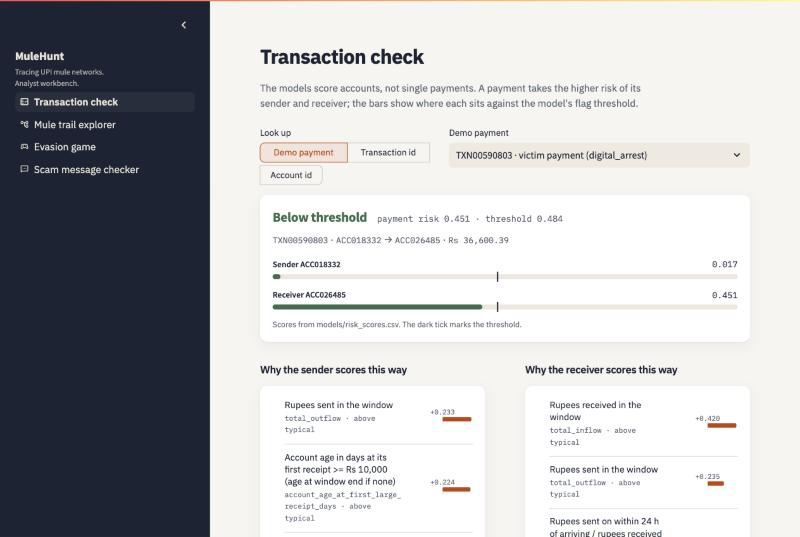
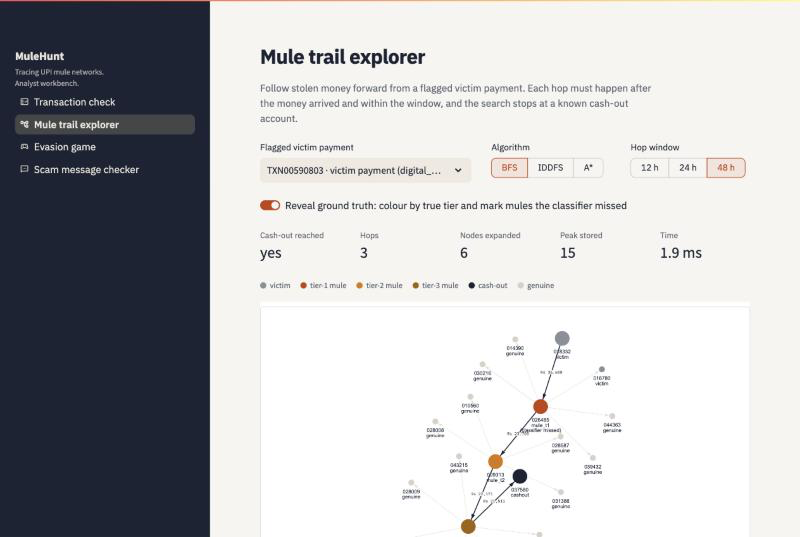
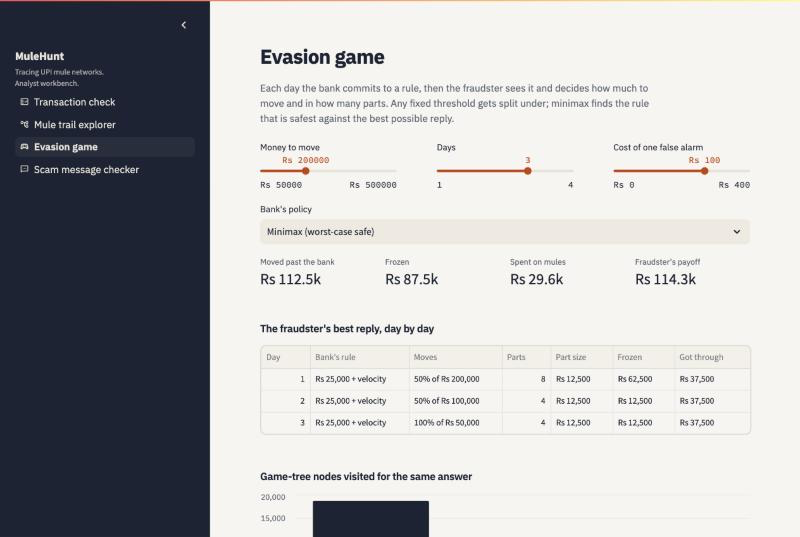
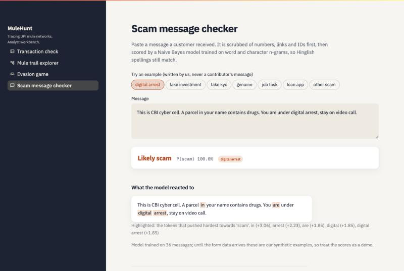

# Chapter 8. The dashboard

> Real transaction data is legally unavailable; we built a simulator calibrated to NPCI/RBI statistics and validated against the IBM AML benchmark.

`streamlit run app/streamlit_app.py` (from the repo root) opens a four-page dashboard for a bank analyst. It starts on a fresh clone with only the toy data and committed files; every page says clearly what is missing and how to regenerate it. Run `python -m app.precompute` once to cache the demo lists. Every page carries the honest-framing footer.

## 8.1 Transaction check

Person A's models score **accounts**, not single payments (B-D19), so a payment is scored by the riskier of its sender and receiver. The page shows both `risk_prob` values, whether each is flagged at the model's threshold (0.484), and the top five `explain()` features with their plain-English meaning.

The default demo payment shows why search is needed: the receiving tier-1 mule scores 0.451, just under the threshold, so the classifier alone would not flag it.

## 8.2 Mule trail explorer

Pick a flagged victim payment, an algorithm (BFS, IDDFS, A\*) and a window (12 / 24 / 48 h); the search runs live with the 200,000-expansion budget. The trail is drawn with pyvis, with one-hop context in grey and nodes coloured by risk. **Reveal ground truth** recolours nodes by their true tier and marks mules the classifier missed.

## 8.3 Evasion game

Sliders for X, R and λ, and a detector policy (minimax or any fixed rule). The page shows the fraudster's best splitting plan per day, the money moved, caught and spent on mules, and the game-tree nodes with and without alpha-beta.

## 8.4 Scam message checker

Paste a message: it is anonymised, then scored by the saved Naive Bayes model. The page shows the scam probability, the likely type and the tokens that pushed it towards "scam". The example buttons use only our **synthetic** messages, never contributors'.

## 8.5 Flags prompt review, not freezes

Each part of the dashboard is wrong some of the time: the classifier misses a third of the mules, trails can pass through genuine accounts, the game's fraudster is a simplification, and the text model is trained on a small, self-selected sample. Freezing an account hurts a real person if the flag is wrong. So every flag in MuleHunt is a prompt for an analyst to look, with the evidence (scores, reasons, the trail) on screen, not an automatic action.
